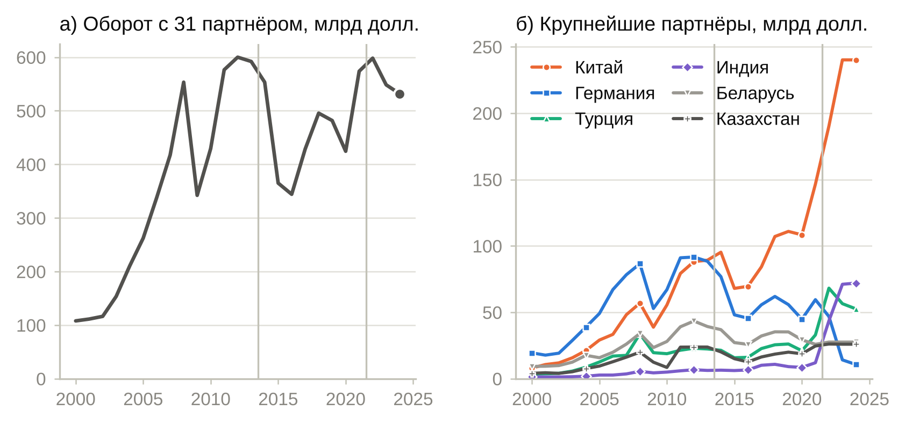
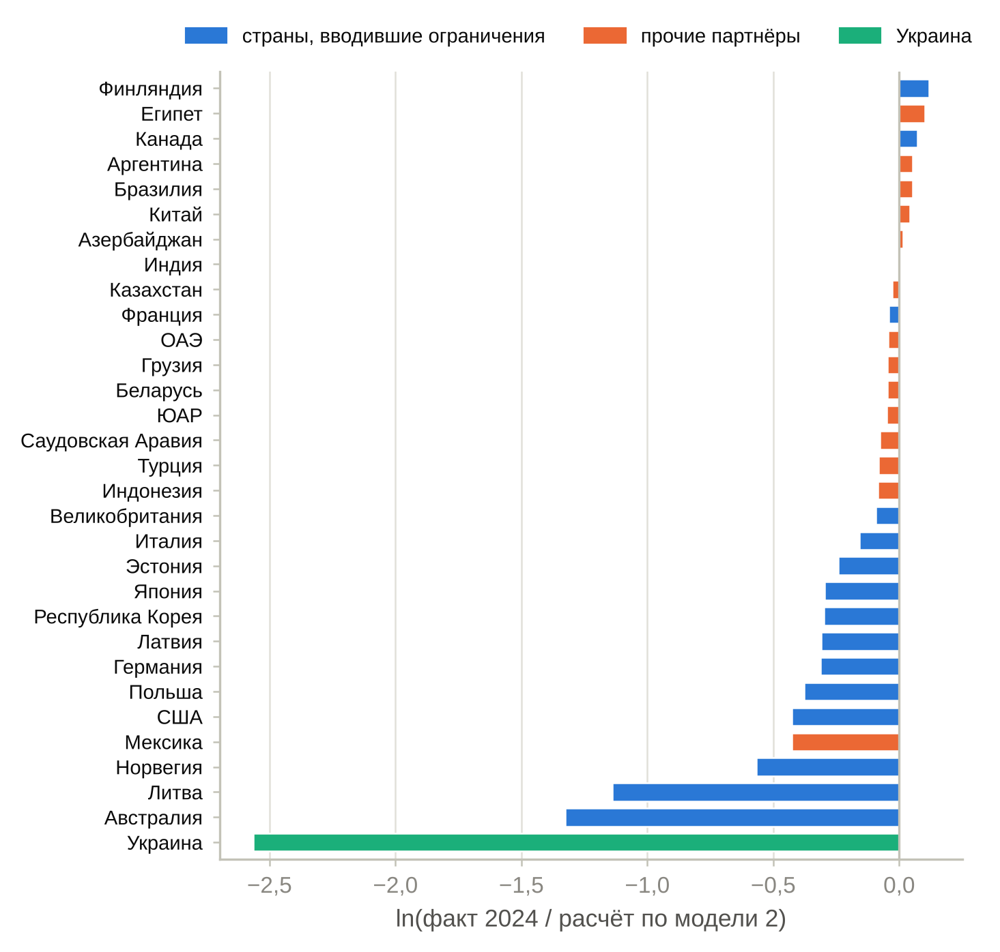

::: {custom-style="Abstract"}
**Аннотация.** В статье оцениваются факторы двустороннего товарооборота России и её основных торговых партнёров на основе гравитационной модели в логарифмически-линейной форме. Эмпирическая база — сбалансированная панель из 496 пар 32 стран за 2000–2024 гг. Последовательно оцениваются статические спецификации (пулированный МНК) с ВВП на душу населения, расстоянием, общей границей и индикаторами членства в ЕС, БРИКС и НАТО, а затем динамические спецификации с лагами зависимой переменной, включая системный обобщённый метод моментов. Статические модели объясняют около четверти вариации товарооборота (R² от 0,225 до 0,267) и характеризуются сильной автокорреляцией остатков; включение лага повышает R² до 0,964, а коэффициент при лаге (0,97 в МНК и 0,90 в системном ОММ) указывает на высокую инерционность торговых потоков. В динамических моделях средний уровень товарооборота в период с 2014 г. ниже на 9–16 % при прочих равных, а совместное членство в БРИКС связано с более высоким товарооборотом. На основе динамических моделей выполнены два расчёта: ожидаемый оборот России с партнёрами в 2024 г. по соотношениям, сложившимся до 2014 г., и прогноз на 2025 г. Обсуждаются ограничения спецификации, прежде всего невозможность отделить эффект санкций от общих для всех стран изменений при использовании индикаторов периода.

**Ключевые слова:** гравитационная модель; внешняя торговля России; панельные данные; динамическая панельная модель; системный ОММ; прогнозирование товарооборота; gretl.

**JEL:** F14, F17, C23, C53.
:::

::: {custom-style="Abstract"}
**Abstract.** The paper estimates the determinants of bilateral trade between Russia and its main trading partners using a log-linear gravity model. The data are a balanced panel of 496 country pairs from 32 countries for 2000–2024. We estimate static specifications (pooled OLS) with GDP per capita, distance, contiguity and EU, BRICS and NATO membership indicators, and then dynamic specifications with lags of the dependent variable, including system GMM. The static models explain about a quarter of the variation in trade (R² from 0.225 to 0.267) and exhibit strong residual autocorrelation; adding the lag raises R² to 0.964, and the lag coefficient (0.97 in OLS and 0.90 in system GMM) points to strong persistence of trade flows. In the dynamic models the average level of trade since 2014 is 9–16% lower, other things equal, and joint BRICS membership is associated with higher trade. Two calculations are based on the dynamic models: Russia's expected trade with partners in 2024 under pre-2014 relationships, and a forecast for 2025. We discuss the limitations of the specification, above all the impossibility of separating the effect of sanctions from changes common to all countries when period indicators are used.

**Keywords:** gravity model; Russian foreign trade; panel data; dynamic panel model; system GMM; trade forecasting; gretl.
:::

# 1. Введение

Внешняя торговля России за последние два с половиной десятилетия пережила несколько резких поворотов: быстрый рост 2000-х гг., спад 2009 г., сокращение оборота в 2014–2016 гг. и глубокую перестройку географической структуры после 2022 г. Количественный анализ факторов, определяющих двусторонние торговые потоки, необходим как для понимания этих изменений, так и для оценки перспектив торговли с отдельными партнёрами.

Наиболее распространённым инструментом такого анализа остаётся гравитационная модель, восходящая к работам Тинбергена [Tinbergen, 1962] и Пёйхёнена [Pöyhönen, 1963]: объём торговли между двумя странами прямо связан с их экономическим размером и обратно — с расстоянием между ними. Привлекательность модели объясняется сочетанием простоты, хорошего согласия с данными и возможности включать в неё дополнительные факторы — общую границу, участие в интеграционных и политических объединениях, торговые ограничения [Anderson, 2011; Head, Mayer, 2014].

Цель статьи — оценить на панельных данных за 2000–2024 гг. факторы товарооборота России и её основных партнёров в рамках гравитационной модели в логарифмически-линейной форме и проверить, насколько такая модель пригодна для краткосрочных прогнозных расчётов. Задачи работы: (1) охарактеризовать динамику и структуру российской внешней торговли; (2) оценить статические спецификации гравитационной модели с ВВП на душу населения, расстоянием и индикаторами общей границы, членства в ЕС, БРИКС и НАТО; (3) учесть инерционность торговли с помощью динамических спецификаций, включая системный обобщённый метод моментов; (4) рассчитать на основе полученных моделей ожидаемый товарооборот России с партнёрами в 2024 г. и прогноз на 2025 г.

Работа носит прикладной характер и опирается на традиционную для прикладной литературы форму гравитационного уравнения. Её результаты следует рассматривать вместе с ограничениями, которые обсуждаются в разделе 7: часть выводов чувствительна к спецификации, а индикаторы периодов 2014 и 2022 гг. не позволяют выделить эффект собственно санкций. Уточнённой (структурной) спецификации, свободной от этих ограничений, посвящена отдельная статья.

Статья построена следующим образом. В разделе 2 кратко излагаются теоретические основы гравитационной модели. Раздел 3 характеризует динамику и структуру внешней торговли России. В разделе 4 описаны данные и спецификации. Разделы 5 и 6 содержат результаты оценивания и прогнозные расчёты, раздел 7 — обсуждение и ограничения, раздел 8 — заключение.

# 2. Гравитационная модель: основы и применение

В исходной форме гравитационное уравнение записывается как $T_{ij} = G\,Y_i^{\alpha}Y_j^{\beta}d_{ij}^{-\gamma}$, где $T_{ij}$ — торговый поток между странами $i$ и $j$, $Y$ — показатели их экономического размера, $d_{ij}$ — расстояние [Tinbergen, 1962; Linnemann, 1966]. После логарифмирования уравнение становится линейным по параметрам и оценивается методом наименьших квадратов; коэффициенты интерпретируются как эластичности. Теоретические обоснования уравнения были получены позднее — на основе моделей с дифференциацией продуктов по стране происхождения [Anderson, 1979], монополистической конкуренции [Bergstrand, 1985] и сравнительных преимуществ [Eaton, Kortum, 2002]; обзор приведён в [Head, Mayer, 2014].

В прикладных работах базовое уравнение расширяют переменными, отражающими издержки торговли и институциональную близость стран: общая граница, общий язык, участие в торговых соглашениях и союзах. Наряду с ВВП в качестве показателя экономического развития используют ВВП на душу населения, связанный с уровнем дохода и структурой спроса [Linder, 1961; Bergstrand, 1985]. Современная методологическая литература указывает на ряд требований к оцениванию — учёт «многосторонних сопротивлений» [Anderson, van Wincoop, 2003], оценивание в уровнях методом пуассоновского квазимаксимального правдоподобия [Santos Silva, Tenreyro, 2006], использование фиксированных эффектов; систематический обзор подходов дан в [Шумилов, 2017].

Отдельное направление связано с динамикой торговли. Двусторонние потоки отличаются высокой устойчивостью во времени: налаженные сбытовые сети, долгосрочные контракты и инфраструктура создают зависимость текущей торговли от прошлой [Eichengreen, Irwin, 1998]. Это мотивирует включение лага зависимой переменной в гравитационное уравнение [Olivero, Yotov, 2012]. В панельных данных лаг зависимой переменной коррелирован с ненаблюдаемыми характеристиками пар стран, поэтому МНК даёт смещённые оценки [Nickell, 1981]; стандартным решением служат оценки обобщённого метода моментов — разностная [Arellano, Bond, 1991] и системная [Blundell, Bond, 1998].

# 3. Внешняя торговля России: динамика и структура

**Динамика.** По данным используемой панели (раздел 4), оборот России с 31 партнёром вырос с 108 млрд долл. в 2000 г. до 600 млрд долл. в 2012 г., сократился до 344 млрд долл. в 2016 г., восстановился до 574 млрд долл. в 2021 г. и составил 532 млрд долл. в 2024 г. (рис. 1 а). При сопоставимом общем объёме радикально изменилась география: оборот с Китаем вырос с 89,3 млрд долл. в 2013 г. до 240,1 млрд долл. в 2024 г., с Индией — с 6,2 до 72,0 млрд долл., с Турцией — с 22,4 до 52,6 млрд долл., тогда как оборот с Германией сократился с 88,4 до 10,7 млрд долл. (рис. 1 б, табл. 1). На три крупнейших партнёра — Китай, Индию и Турцию — в 2024 г. приходилось 69 % оборота России со странами выборки.

{width=15.5cm}

Table: Таблица 1 — Крупнейшие торговые партнёры России среди стран выборки: товарооборот, млрд долл. США, и доля в обороте со странами выборки. Источник: расчёты автора по данным панели (UN Comtrade).

| Партнёр | 2013 | 2021 | 2024 | Доля, 2013, % | Доля, 2024, % |
|:---------------------------|:--------------:|:--------------:|:--------------:|:----------------:|:----------------:|
| Китай | 89,3 | 146,5 | 240,1 | 15,1 | 45,2 |
| Индия | 6,2 | 12,0 | 72,0 | 1,1 | 13,5 |
| Турция | 22,4 | 32,9 | 52,6 | 3,8 | 9,9 |
| Беларусь | 39,3 | 25,9 | 27,6 | 6,6 | 5,2 |
| Казахстан | 23,8 | 24,6 | 26,0 | 4,0 | 4,9 |
| Бразилия | 5,9 | 7,8 | 13,7 | 1,0 | 2,6 |
| Республика Корея | 22,6 | 27,3 | 11,4 | 3,8 | 2,1 |
| ОАЭ | 2,5 | 5,4 | 10,9 | 0,4 | 2,1 |
| Германия | 88,4 | 59,5 | 10,7 | 14,9 | 2,0 |
| Франция | 24,3 | 18,9 | 9,9 | 4,1 | 1,9 |
| Италия | 41,1 | 31,1 | 8,4 | 6,9 | 1,6 |
| Япония | 34,6 | 22,0 | 7,8 | 5,8 | 1,5 |

**Структура.** По данным Федеральной таможенной службы, в 2024 г. экспорт товаров России составил 433,9 млрд долл., импорт — 283,0 млрд долл. (табл. 2). На страны Азии пришлось 75,9 % экспорта и 67,6 % импорта; экспорт в Азию вырос к 2023 г. на 7,6 %, в Африку — на 14,7 %, тогда как экспорт в Европу сократился на 20,4 %. В товарной структуре экспорта преобладают минеральные продукты (60,9 %), металлы и изделия из них (14,7 %) и продовольственные товары и сельскохозяйственное сырьё (9,8 %); в импорте — машины, оборудование и транспортные средства (52,0 %), продукция химической промышленности (18,9 %) и продовольствие (13,3 %). Сырьевая специализация экспорта определяет его чувствительность к ценам на энергоносители и к ограничениям на поставки, а высокая доля инвестиционных товаров в импорте — зависимость от доступа к поставщикам оборудования.

Table: Таблица 2 — Экспорт и импорт товаров России по группам стран, 2024 г. Источник: Федеральная таможенная служба России.

| Группа стран | Экспорт, млрд долл. | Доля, % | К 2023 г., % | Импорт, млрд долл. | Доля, %  | К 2023 г., %  |
|:---------------------|:----------------:|:-----------:|:-------------:|:----------------:|:-----------:|:-------------:|
| Весь мир | 433,9 | 100,0 | +2,0 | 283,0 | 100,0 | −0,8 |
| Европа | 68,4 | 15,8 | −20,4 | 73,1 | 25,8 | −6,9 |
| Азия | 329,2 | 75,9 | +7,6 | 191,2 | 67,6 | +1,9 |
| Африка | 24,3 | 5,6 | +14,7 | 3,5 | 1,2 | +3,5 |
| Америка | 11,9 | 2,7 | −1,7 | 14,8 | 5,2 | −1,8 |
| Океания | 0,0 | 0,0 | −22,2 | 0,1 | 0,0 | −26,2 |

Таким образом, к середине 2020-х гг. сложилась новая конфигурация российской торговли: резкое снижение роли европейских партнёров и концентрация оборота на нескольких крупных азиатских экономиках. Гравитационная модель позволяет проверить, в какой мере наблюдаемые объёмы двусторонней торговли согласуются с уровнем экономического развития партнёров, расстоянием и участием стран в международных объединениях.

# 4. Данные и спецификация модели

**Выборка.** Панель включает 32 страны — Россию и 31 её торгового партнёра (Австралия, Азербайджан, Аргентина, Беларусь, Бразилия, Великобритания, Германия, Грузия, Египет, Индия, Индонезия, Италия, Казахстан, Канада, Китай, Латвия, Литва, Мексика, Норвегия, ОАЭ, Польша, Республика Корея, Саудовская Аравия, США, Турция, Украина, Финляндия, Франция, Эстония, ЮАР, Япония) — за 2000–2024 гг. В выборку вошли государства, для которых доступны полные ряды данных. Единица наблюдения — пара стран в данном году; учитываются все 496 пар, а не только пары с участием России, что даёт 12 400 наблюдений.

**Переменные.** Зависимая переменная — товарооборот пары (сумма экспорта и импорта) в текущих долларах США по данным UN Comtrade. Уровень экономического развития измеряется ВВП на душу населения в текущих долларах (Всемирный банк; за последние годы — оценки МВФ). Расстояние — расстояние между столицами. Фиктивные переменные: общая сухопутная граница; совместное членство в ЕС, в БРИКС и в НАТО (переменная равна единице, если обе страны пары входят в объединение в данном году); индикаторы периодов с 2014 г. ($D1$) и с 2022 г. ($D6$), соответствующих двум этапам введения ограничительных мер в отношении России. Описательная статистика приведена в табл. 3.

Table: Таблица 3 — Описательная статистика переменных (496 пар, 2000–2024 гг.). Источник: расчёты автора.

| Переменная | N | Среднее | Ст. откл. | Мин. | Макс. |
|:---------------------------------------|:-----------:|:-------------:|:-------------:|:-----------:|:-------------:|
| Товарооборот, млн долл. | 12400 | 13142 | 46977 | 0,01 | 761713 |
| ВВП на душу населения, страна i, долл. | 12400 | 22090 | 20185 | 443 | 108908 |
| ВВП на душу населения, страна j, долл. | 12400 | 21794 | 21052 | 443 | 108908 |
| Расстояние, км | 12400 | 6800 | 4541 | 82,25 | 19628 |
| Общая граница | 12400 | 0,07 | 0,25 | 0,00 | 1,00 |
| ЕС (обе страны) | 12400 | 0,06 | 0,24 | 0,00 | 1,00 |
| БРИКС (обе страны) | 12400 | 0,01 | 0,12 | 0,00 | 1,00 |
| НАТО (обе страны) | 12400 | 0,12 | 0,33 | 0,00 | 1,00 |
| Период с 2014 г. | 12400 | 0,44 | 0,50 | 0,00 | 1,00 |
| Период с 2022 г. | 12400 | 0,12 | 0,32 | 0,00 | 1,00 |

**Статическая спецификация.** Базовое уравнение имеет вид

$$\ln T_{ijt} = \alpha + \beta_1 \ln y_{it} + \beta_2 \ln y_{jt} + \delta \ln d_{ij} + \boldsymbol{\lambda}^{\top}\mathbf{D}_{ijt} + \varepsilon_{ijt}, \qquad (1)$$

где $T_{ijt}$ — товарооборот стран $i$ и $j$ в году $t$; $y_{it}$, $y_{jt}$ — ВВП на душу населения; $d_{ij}$ — расстояние; $\mathbf{D}_{ijt}$ — вектор фиктивных переменных; $\varepsilon_{ijt}$ — случайная ошибка. Уравнение (1) оценивается пулированным МНК. Ожидаемые знаки: $\beta_1, \beta_2 > 0$, $\delta < 0$; коэффициенты при индикаторах общей границы и членства в объединениях положительны.

**Динамическая спецификация.** Для учёта инерционности торговли в уравнение включаются лаги зависимой переменной:

$$\ln T_{ijt} = \alpha + \sum_{k=1}^{K}\rho_k \ln T_{ij,t-k} + \beta_1 \ln y_{it} + \beta_2 \ln y_{jt} + \delta \ln d_{ij} + \boldsymbol{\lambda}^{\top}\mathbf{D}_{ijt} + \varepsilon_{ijt}, \qquad K = 1, 2, 3. \qquad (2)$$

Коэффициенты уравнения (2) измеряют краткосрочные эффекты; долгосрочный эффект фактора равен его коэффициенту, делённому на $1 - \sum_k \rho_k$. Уравнение (2) оценивается пулированным МНК, а при $K = 1$ — также системным обобщённым методом моментов [Blundell, Bond, 1998], в котором лаг зависимой переменной инструментируется её более глубокими лагами в уравнении в разностях и лагами разностей в уравнении в уровнях (одношаговая оценка).

**Порядок анализа.** Сначала модели оцениваются на данных за 2000–2014 гг. (модели 1 и 2), что позволяет получить соотношения, характерные для периода до изменения внешних условий, и использовать их для расчёта ожидаемого оборота в последующие годы. Затем на полной выборке последовательно добавляются фиктивные переменные (модели 3 и 4) и лаги зависимой переменной (модели 5–7); модель 8 оценивается системным ОММ. Расчёты выполнены в пакете gretl [Cottrell, Lucchetti, 2023] и воспроизведены на языке Python; скрипты и данные доступны в репозитории.

# 5. Результаты оценивания

## 5.1. Статические модели

Результаты оценивания уравнения (1) приведены в табл. 4. В базовой модели на данных за 2000–2014 гг. (столбец 1) все коэффициенты значимы и имеют ожидаемые знаки: эластичность товарооборота по ВВП на душу населения равна 0,39 и 0,84, по расстоянию — −0,29. Модель воспроизводит основные закономерности гравитационного уравнения, однако объясняет лишь 23 % вариации логарифма товарооборота, а статистика Дарбина — Уотсона (0,03) указывает на сильную положительную автокорреляцию остатков: отклонения торговли пары от расчётного уровня устойчивы во времени.

Table: Таблица 4 — Статические модели: пулированный МНК. Зависимая переменная — логарифм товарооборота. В скобках — стандартные ошибки. * p < 0,10; ** p < 0,05; *** p < 0,01.

| Переменная | (1) МНК, 2000–2014 | (3) МНК | (4) МНК |
|:--------------------------------------|:---------------------:|:---------------------:|:---------------------:|
| ln ВВП на душу населения, страна i | 0,393*** (0,021) | 0,376*** (0,017) | 0,336*** (0,018) |
| ln ВВП на душу населения, страна j | 0,839*** (0,021) | 0,848*** (0,017) | 0,819*** (0,018) |
| ln расстояния | −0,289*** (0,028) | 0,010 (0,024) | 0,096*** (0,027) |
| Общая граница |  | 2,331*** (0,090) | 2,300*** (0,090) |
| ЕС (обе страны) |  |  | 0,219** (0,102) |
| БРИКС (обе страны) |  |  | 2,952*** (0,174) |
| НАТО (обе страны) |  |  | 0,733*** (0,074) |
| Период с 2014 г. (D1) |  | 0,106** (0,042) | 0,107** (0,045) |
| Период с 2022 г. (D6) |  |  | −0,112* (0,067) |
| Константа | 4,739*** (0,359) | 2,121*** (0,306) | 1,908*** (0,306) |
| Число наблюдений | 7440 | 12400 | 12400 |
| R² | 0,225 | 0,241 | 0,267 |
| Статистика Дарбина — Уотсона | 0,031 | 0,042 | 0,048 |

На полной выборке (столбцы 3 и 4) коэффициенты при ВВП на душу населения сохраняют величину и значимость. Общая граница связана с существенно более высоким товарооборотом (2,30). В модели 4 значимы и положительны коэффициенты при индикаторах членства в ЕС (0,22), НАТО (0,73) и особенно БРИКС (2,95). Вместе с тем ряд результатов не согласуется с ожиданиями. Во-первых, коэффициент при расстоянии теряет значимость в модели 3 и становится положительным в модели 4 (0,10). Во-вторых, коэффициент при индикаторе периода с 2014 г. положителен (0,11), а при индикаторе периода с 2022 г. — отрицателен и значим лишь на 10 %-м уровне (−0,11). В-третьих, величина коэффициента при БРИКС соответствует товарообороту в 19,2 раза выше, чем у прочих пар с теми же характеристиками, что трудно признать правдоподобной оценкой эффекта объединения, не являющегося зоной свободной торговли.

Эти особенности объясняются свойствами спецификации. ВВП на душу населения отражает уровень дохода, но не размер экономики, поэтому различия в масштабах торговли крупных по населению стран — Китая, Индии, Бразилии, России — приписываются индикатору БРИКС; аналогично индикаторы ЕС и НАТО вбирают в себя особенности торговли между развитыми странами. Индикаторы периодов равны единице для всех пар выборки и измеряют общее изменение среднего уровня торговли после 2014 и 2022 гг. (при данных уровнях подушевого ВВП), а не изменение торговли России с отдельными странами. Низкая объясняющая способность и автокорреляция остатков показывают, что статическая спецификация не учитывает устойчивые особенности пар стран; это мотивирует переход к динамическим моделям.

## 5.2. Динамические модели

Включение лага зависимой переменной радикально меняет картину (табл. 5). Уже в модели 2 (2000–2014 гг.) коэффициент при лаге равен 0,97, R² возрастает до 0,971, а статистика Дарбина — Уотсона (2,27) приближается к двум. На полной выборке (модель 5) коэффициент при лаге — 0,972, R² — 0,964. При включении двух и трёх лагов (модели 6 и 7) сумма коэффициентов при лагах составляет 0,98 и 0,98. Товарооборот пары в данном году почти полностью предсказывается его прошлыми значениями: торговые связи складываются годами и меняются медленно.

Table: Таблица 5 — Динамические модели: пулированный МНК (2, 5–7) и системный ОММ (8). Зависимая переменная — логарифм товарооборота. В скобках — стандартные ошибки. * p < 0,10; ** p < 0,05; *** p < 0,01.

| Переменная | (2) МНК с лагом, 2000–2014 | (5) МНК с лагом | (6) МНК, два лага | (7) МНК, три лага | (8) Системный ОММ |
|:---------------------------|:---------------:|:---------------:|:---------------:|:---------------:|:---------------:|
| ln ВВП на душу населения, страна i | −0,012*** (0,004) | −0,006 (0,004) | −0,010** (0,004) | −0,020*** (0,004) | 0,024** (0,010) |
| ln ВВП на душу населения, страна j | −0,003 (0,005) | 0,004 (0,004) | −0,003 (0,004) | −0,014*** (0,005) | 0,064*** (0,017) |
| ln расстояния | −0,010* (0,006) | 0,002 (0,006) | −0,002 (0,005) | 0,006 (0,005) | −0,023** (0,010) |
| Общая граница |  | 0,014 (0,021) |  |  |  |
| ЕС (обе страны) |  | 0,001 (0,023) |  |  |  |
| БРИКС (обе страны) |  | 0,085** (0,039) | 0,068* (0,038) |  | 0,283*** (0,068) |
| НАТО (обе страны) |  | 0,037** (0,017) |  | 0,047*** (0,016) |  |
| Период с 2014 г. (D1) |  | −0,107*** (0,010) | −0,141*** (0,009) | −0,176*** (0,010) | −0,099*** (0,009) |
| Период с 2022 г. (D6) |  | 0,001 (0,015) |  | 0,035** (0,015) |  |
| ln оборота (t−1) | 0,972*** (0,002) | 0,972*** (0,002) | 0,803*** (0,009) | 0,776*** (0,010) | 0,905*** (0,017) |
| ln оборота (t−2) |  |  | 0,172*** (0,009) | 0,080*** (0,013) |  |
| ln оборота (t−3) |  |  |  | 0,121*** (0,010) |  |
| Константа | 0,727*** (0,073) | 0,507*** (0,070) | 0,638*** (0,067) | 0,775*** (0,070) | 0,805*** (0,139) |
| Число наблюдений | 6944 | 11904 | 11408 | 10912 | 11904 |
| R² | 0,971 | 0,964 | 0,964 | 0,963 | — |
| Статистика Дарбина — Уотсона | 2,265 | 2,187 | 1,926 | 1,886 | — |

При контроле прошлой торговли коэффициенты при ВВП на душу населения, расстоянии и общей границе в МНК-оценках близки к нулю: влияние этих медленно меняющихся факторов уже содержится в лагированном товарообороте. Коэффициент при индикаторе периода с 2014 г. становится отрицательным и высокозначимым во всех спецификациях — от −0,107 (модель 5) до −0,176 (модель 7): при прочих равных товарооборот пар стран в этот период в среднем ниже на 10 %–16 % в краткосрочном выражении. Знак этого коэффициента в статических моделях был противоположным, т. е. вывод о направлении изменения зависит от того, учитывается ли инерция торговли. Коэффициент при индикаторе периода с 2022 г. незначим в модели 5 и невелик в модели 7 (0,035). Совместное членство в БРИКС связано с более высоким товарооборотом (0,085 в модели 5), в НАТО — также (0,037), тогда как коэффициент при индикаторе ЕС неотличим от нуля.

Оценки МНК в уравнении с лагом зависимой переменной смещены, если существуют ненаблюдаемые постоянные характеристики пар: коэффициент при лаге завышается. Модель 8, оценённая системным ОММ, даёт меньший коэффициент при лаге — 0,905, и в ней вновь значимы «гравитационные» переменные: эластичность по ВВП на душу населения составляет 0,024 и 0,064, по расстоянию — −0,023. В долгосрочном выражении это соответствует эластичностям 0,25, 0,68 и −0,25. Коэффициент при индикаторе периода с 2014 г. равен −0,099 (краткосрочное снижение на 9 %), при индикаторе БРИКС — 0,283 (товарооборот выше на 33 % в краткосрочном выражении).

Диагностика модели 8 неоднозначна. Тест на автокорреляцию первого порядка в разностях отвергает нулевую гипотезу (z = −9,08), второго порядка — не отвергает (z = 0,70, p = 0,48), что согласуется с предпосылками метода. Однако тест Саргана уверенно отвергает гипотезу о валидности инструментов (χ²(298) = 2484,0, p < 0,001). Тест Саргана не робастен к гетероскедастичности, а при 305 инструментах оценки могут быть смещены из-за их избыточного числа [Roodman, 2009]; тем не менее отвержение гипотезы указывает на то, что условия ортогональности, вероятно, выполняются не для всех инструментов. Оценки модели 8 поэтому следует считать ориентировочными.

# 6. Прогнозные расчёты

## 6.1. Ожидаемый оборот 2024 г. по соотношениям периода до 2014 г.

Модель 2 оценена на данных за 2000–2014 гг. и описывает связь текущего товарооборота с прошлым, сложившуюся до изменения внешних условий. Подставив в неё фактические значения 2023 г. (товарооборот) и 2024 г. (ВВП на душу населения), получаем расчётный оборот России с каждым партнёром на 2024 г.:

$$\widehat{\ln T}_{ij,2024} = 0,727 −0,012\,\ln y_{i,2024} −0,003\,\ln y_{j,2024} −0,010\,\ln d_{ij} + 0,972\,\ln T_{ij,2023}. \qquad (3)$$

Расчёт является одношаговым прогнозом: он показывает, каким был бы оборот 2024 г., если бы он соотносился с оборотом предыдущего года так же, как в среднем в 2000–2014 гг. Отклонение факта от расчёта характеризует изменение торговли за один год сверх «обычной» инерции, а не накопленный с 2014 г. эффект.

Суммарный расчётный оборот России с 31 партнёром составляет 549 млрд долл. при фактических 532 млрд долл. (отклонение −3,2 %). Для 24 из 31 партнёров факт ниже расчёта (рис. 2). Наибольшие отрицательные отклонения — у Украины, Австралии и Литвы; заметно ниже расчётного оборот с Норвегией, США (3,8 против 5,8 млрд долл.), Польшей, Германией (10,7 против 14,6 млрд долл.), Республикой Корея и Японией. Выше расчётного оказался оборот с Китаем (на 9,8 млрд долл.), Бразилией, Египтом, Аргентиной и Азербайджаном, а также с Канадой и Финляндией. Среднее абсолютное отклонение в логарифмах равно 0,31.

{width=11.5cm}

Общая картина согласуется с переориентацией торговли: отрицательные отклонения сосредоточены в группе стран, вводивших ограничения, положительные — среди прочих партнёров. Следует, однако, учитывать особенность исходных данных: для 7 партнёров (в их числе Китай, Беларусь, Казахстан, ОАЭ и Франция) значение оборота 2024 г. в наборе совпадает со значением 2023 г., т. е. данные за 2024 г. на момент формирования набора отсутствовали и были заменены предыдущими. Для этих стран отклонение от расчёта отражает только свойства модели (коэффициент при лаге меньше единицы), но не фактическую динамику.

## 6.2. Прогноз на 2025 г.

Прогноз на 2025 г. построен по модели 8. В уравнение подставлены фактический оборот 2024 г., прогнозные значения ВВП на душу населения на 2025 г. (МВФ, World Economic Outlook) и значения фиктивных переменных:

$$\widehat{\ln T}_{ij,2025} = 0,805 + 0,905\,\ln T_{ij,2024} + 0,024\,\ln y_{i,2025} + 0,064\,\ln y_{j,2025} −0,023\,\ln d_{ij} −0,099\,D1 + 0,283\,\text{BRICS}_{ij}. \qquad (4)$$

Согласно прогнозу, суммарный оборот России с 31 партнёром в 2025 г. составит 443 млрд долл. против 532 млрд долл. в 2024 г. (−17 %; табл. 6). Снижение прогнозируется прежде всего для крупнейших партнёров — Турции (−26 %), Беларуси (−24 %), Казахстана (−23 %), Китая (−19 %) и Индии (−17 %), рост — для партнёров с малым текущим оборотом (Австралия, Украина, Норвегия, ЮАР, Финляндия). Такая структура прогноза — следствие коэффициента при лаге, меньшего единицы: модель предсказывает возврат оборота каждой пары к уровню, определяемому её «гравитационными» характеристиками, поэтому оборот выше этого уровня должен снижаться, а ниже — расти.

Table: Таблица 6 — Прогноз оборота России с партнёрами на 2025 г. по модели 8, млрд долл. США. Партнёры упорядочены по обороту 2024 г. Источник: расчёты автора.

| Партнёр | Факт 2024 | Прогноз 2025 | Прогноз к 2024, % |
|:--------------------------------------|:---------------------:|:---------------------:|:---------------------:|
| Китай | 240,1 | 194,5 | −19 |
| Индия | 72,0 | 59,6 | −17 |
| Турция | 52,6 | 38,8 | −26 |
| Беларусь | 27,6 | 21,1 | −24 |
| Казахстан | 26,0 | 20,1 | −23 |
| Бразилия | 13,7 | 14,1 | +3 |
| Республика Корея | 11,4 | 9,9 | −13 |
| ОАЭ | 10,9 | 9,9 | −10 |
| Германия | 10,7 | 9,9 | −7 |
| Франция | 9,9 | 9,0 | −8 |
| Италия | 8,4 | 7,8 | −8 |
| Япония | 7,8 | 7,0 | −11 |
| Египет | 6,6 | 7,0 | +6 |
| Польша | 4,8 | 4,7 | −4 |
| Азербайджан | 4,8 | 4,2 | −12 |
| США | 3,8 | 3,9 | +2 |
| Саудовская Аравия | 3,7 | 3,6 | −3 |
| Индонезия | 3,3 | 3,8 | +13 |
| Канада | 2,6 | 2,6 | +2 |
| Грузия | 2,5 | 2,4 | −5 |
| Латвия | 1,5 | 1,7 | +8 |
| Мексика | 1,4 | 1,4 | −2 |
| Эстония | 1,2 | 1,4 | +12 |
| Великобритания | 1,2 | 1,3 | +13 |
| Литва | 0,9 | 1,1 | +15 |
| ЮАР | 0,9 | 1,1 | +31 |
| Финляндия | 0,5 | 0,6 | +26 |
| Аргентина | 0,5 | 0,5 | +9 |
| Норвегия | 0,3 | 0,4 | +35 |
| Украина | 0,0 | 0,0 | +47 |
| Австралия | 0,0 | 0,0 | +90 |

# 7. Обсуждение и ограничения

Полученные оценки позволяют сделать три содержательных наблюдения и требуют ряда оговорок.

**Инерционность.** Главный устойчивый результат — высокая зависимость текущего товарооборота от прошлого: коэффициент при лаге близок к единице во всех динамических спецификациях. С содержательной точки зрения это означает, что налаженные торговые связи меняются медленно, а эффекты внешних шоков распределены во времени: краткосрочное снижение на 10 % при коэффициенте инерции 0,9 соответствует многократно большему долгосрочному изменению. С эконометрической точки зрения близость коэффициента к единице означает, что ряды товарооборота близки к нестационарным; оценки МНК в таких условиях завышают коэффициент при лаге, а системный ОММ чувствителен к выбору инструментов.

**Период с 2014 г.** Во всех динамических моделях средний уровень товарооборота в период с 2014 г. ниже, чем следовало бы из прошлой торговли и подушевого ВВП. Интерпретировать этот результат как эффект санкций против России было бы неверно: индикаторы $D1$ и $D6$ равны единице для всех 496 пар, включая пары без участия России, и поэтому отражают общие для выборки изменения — падение цен на сырьё в 2014–2016 гг., замедление мировой торговли, пандемию — наряду с возможным влиянием ограничений. Смена знака коэффициента при переходе от статических моделей к динамическим дополнительно показывает неустойчивость этой оценки. Для выделения эффекта санкций необходимы индикаторы, определённые на уровне пар «Россия — страна, вводившая ограничения», и группа сравнения.

**Объединения.** Положительная связь товарооборота с совместным членством в БРИКС сохраняется во всех моделях, однако её величина меняется от 0,08 до 2,95. В статических моделях коэффициент заведомо завышен, поскольку индикатор объединяет крупнейшие развивающиеся экономики, а размер экономики в уравнении не учтён. Более осторожный вывод состоит в том, что торговля между странами БРИКС выше, чем предсказывает модель с подушевым ВВП и расстоянием; делать заключение о причинном эффекте членства эти оценки не позволяют.

**Ограничения спецификации.** (1) В уравнении используется ВВП на душу населения, а не ВВП; теоретически обоснованные версии гравитационной модели включают показатели экономического размера. (2) Не учтены «многосторонние сопротивления» [Anderson, van Wincoop, 2003], что может смещать оценки коэффициентов при расстоянии и индикаторах объединений. (3) Обозначение стран пары индексами $i$ и $j$ в наборе данных условно, поэтому различие коэффициентов при $\ln y_i$ и $\ln y_j$ не имеет содержательной интерпретации. (4) Логарифмическая форма при гетероскедастичности даёт смещённые оценки эластичностей [Santos Silva, Tenreyro, 2006]. (5) Расстояния между столицами и значения товарооборота за последние годы в исходном наборе содержат неточности; для части пар данные 2024 г. повторяют 2023 г. (6) Положительный знак коэффициента при расстоянии в модели 4 показывает, что статическая спецификация с полным набором фиктивных переменных не идентифицирует эффект расстояния.

**Прогнозные свойства.** Высокий R² динамических моделей отражает главным образом устойчивость уровней торговли и не означает высокой точности прогноза изменений: прогноз по модели с лагом воспроизводит прошлогодний оборот с поправкой на возврат к среднему. В условиях структурных сдвигов — резкой переориентации торговли — модели, основанные на средних по выборке соотношениях, не могут предсказать направление изменений для отдельных партнёров.

Перечисленные ограничения определяют направления развития модели: переход к показателям экономического размера, оценивание в уровнях методом пуассоновского квазимаксимального правдоподобия, включение фиксированных эффектов «страна — год» и «пара», определение санкционных индикаторов на уровне пар стран. Эти задачи решаются в следующей статье цикла.

# 8. Заключение

В работе на панели из 496 пар 32 стран за 2000–2024 гг. оценены статические и динамические спецификации гравитационной модели товарооборота России и её основных торговых партнёров.

Базовая модель подтверждает исходные закономерности: товарооборот положительно связан с ВВП на душу населения стран и отрицательно — с расстоянием между ними; наличие общей границы и совместное членство в международных объединениях связаны с более высоким товарооборотом. Вместе с тем статические модели объясняют около четверти вариации товарооборота, а при расширении набора фиктивных переменных коэффициент при расстоянии теряет ожидаемый знак.

Учёт инерционности торговли существенно улучшает описание данных: коэффициент при лаге товарооборота составляет 0,90–0,97, а объясняющая способность моделей превышает 96 %. В динамических моделях средний уровень товарооборота в период с 2014 г. ниже на 9–16 % в краткосрочном выражении; совместное членство в БРИКС связано с более высоким товарооборотом. Эти оценки характеризуют средние по всей выборке изменения и не могут быть отнесены на счёт санкций.

Расчёт по соотношениям периода до 2014 г. показывает, что в 2024 г. оборот России с большинством стран, вводивших ограничения, был ниже ожидаемого, а с Китаем, Бразилией, Египтом и рядом других партнёров — выше. Прогноз на 2025 г. по динамической панельной модели предполагает снижение суммарного оборота со странами выборки.

Практическое значение результатов состоит в количественной характеристике инерционности торговых связей и в выявлении партнёров, оборот с которыми отклоняется от ожидаемого. Методическое значение — в демонстрации границ применимости традиционной логарифмически-линейной гравитационной модели: оценка эффектов санкций и интеграционных объединений требует структурной спецификации, которой посвящена следующая статья.

**Благодарности.** [Указать: исходный набор данных и расчёты подготовлены в рамках выпускной квалификационной работы ФИО студента.]

**Доступность данных и кода.** Данные, скрипты gretl и Python размещены в репозитории: https://github.com/mv145x-ship-it/GM

# Литература

1. Шумилов А. В. Оценивание гравитационных моделей международной торговли: обзор основных подходов // Экономический журнал ВШЭ. 2017. Т. 21. № 2. С. 224–250.
2. Anderson J. E. A theoretical foundation for the gravity equation // American Economic Review. 1979. Vol. 69. No. 1. P. 106–116.
3. Anderson J. E. The gravity model // Annual Review of Economics. 2011. Vol. 3. P. 133–160.
4. Anderson J. E., van Wincoop E. Gravity with gravitas: a solution to the border puzzle // American Economic Review. 2003. Vol. 93. No. 1. P. 170–192.
5. Arellano M., Bond S. Some tests of specification for panel data: Monte Carlo evidence and an application to employment equations // Review of Economic Studies. 1991. Vol. 58. No. 2. P. 277–297.
6. Bergstrand J. H. The gravity equation in international trade: some microeconomic foundations and empirical evidence // Review of Economics and Statistics. 1985. Vol. 67. No. 3. P. 474–481.
7. Blundell R., Bond S. Initial conditions and moment restrictions in dynamic panel data models // Journal of Econometrics. 1998. Vol. 87. No. 1. P. 115–143.
8. Cottrell A., Lucchetti R. Gretl User's Guide: Gnu Regression, Econometrics and Time-series Library. 2023.
9. Eaton J., Kortum S. Technology, geography, and trade // Econometrica. 2002. Vol. 70. No. 5. P. 1741–1779.
10. Eichengreen B., Irwin D. A. The role of history in bilateral trade flows // The Regionalization of the World Economy / ed. J. A. Frankel. Chicago: University of Chicago Press, 1998. P. 33–57.
11. Head K., Mayer T. Gravity equations: workhorse, toolkit, and cookbook // Handbook of International Economics. Vol. 4 / eds. G. Gopinath, E. Helpman, K. Rogoff. Amsterdam: Elsevier, 2014. P. 131–195.
12. Linder S. B. An Essay on Trade and Transformation. Stockholm: Almqvist & Wiksell, 1961.
13. Linnemann H. An Econometric Study of International Trade Flows. Amsterdam: North-Holland, 1966.
14. Nickell S. Biases in dynamic models with fixed effects // Econometrica. 1981. Vol. 49. No. 6. P. 1417–1426.
15. Olivero M. P., Yotov Y. V. Dynamic gravity: endogenous country size and asset accumulation // Canadian Journal of Economics. 2012. Vol. 45. No. 1. P. 64–92.
16. Pöyhönen P. A tentative model for the volume of trade between countries // Weltwirtschaftliches Archiv. 1963. Bd. 90. S. 93–100.
17. Roodman D. A note on the theme of too many instruments // Oxford Bulletin of Economics and Statistics. 2009. Vol. 71. No. 1. P. 135–158.
18. Santos Silva J. M. C., Tenreyro S. The log of gravity // Review of Economics and Statistics. 2006. Vol. 88. No. 4. P. 641–658.
19. Tinbergen J. Shaping the World Economy: Suggestions for an International Economic Policy. New York: Twentieth Century Fund, 1962.

**Источники данных**

20. Федеральная таможенная служба России. Экспорт и импорт товаров Российской Федерации по группам стран и товаров, январь–декабрь 2023–2024 гг.
21. UN Comtrade Database. United Nations Statistics Division.
22. World Development Indicators. World Bank; World Economic Outlook Database. International Monetary Fund.