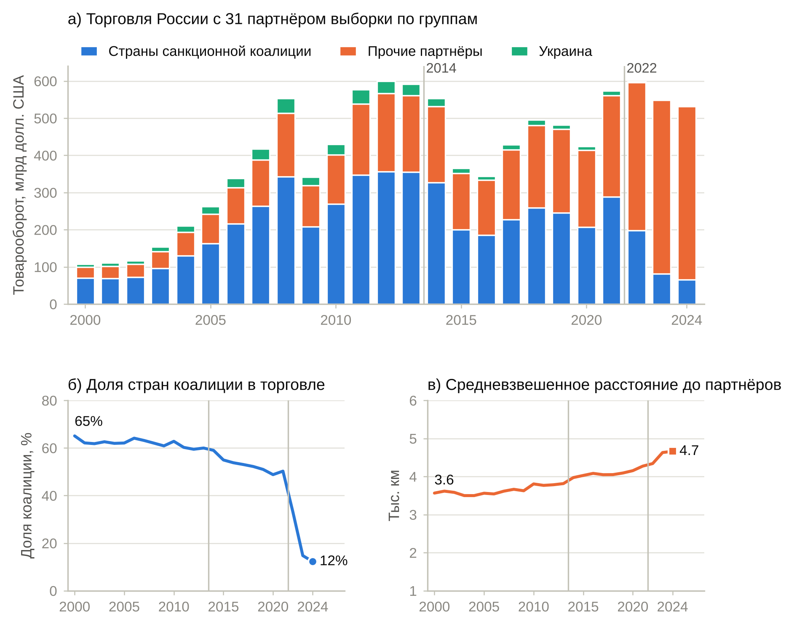
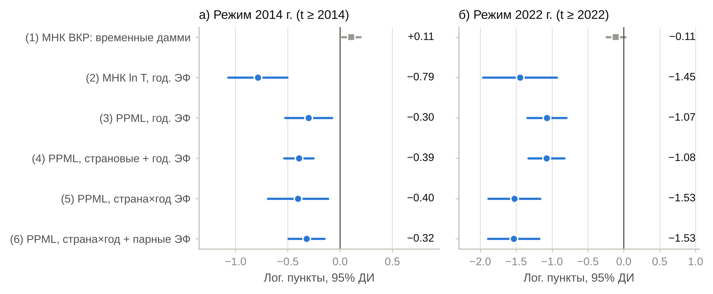
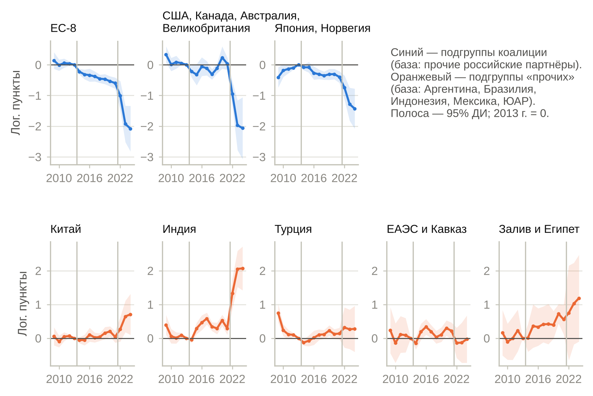
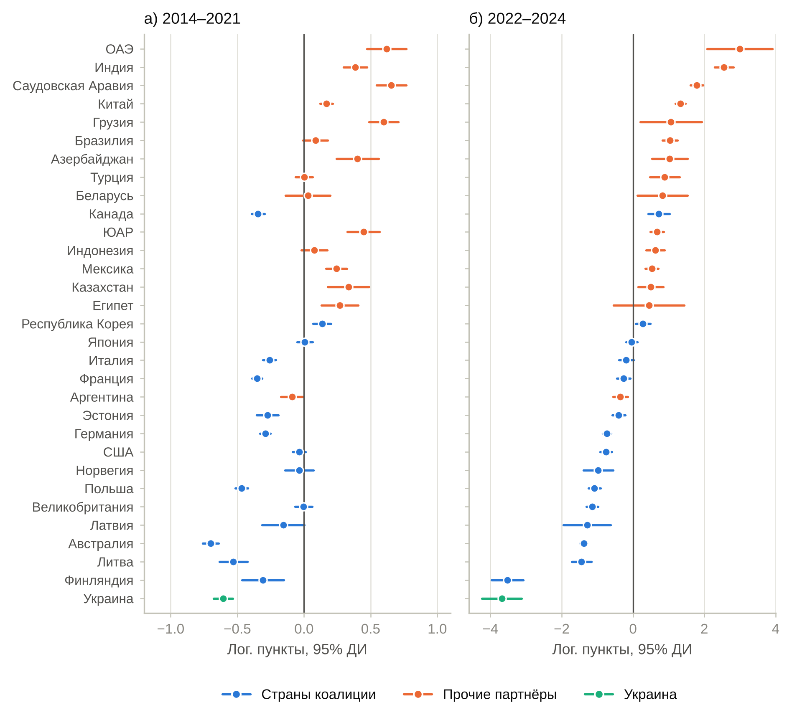
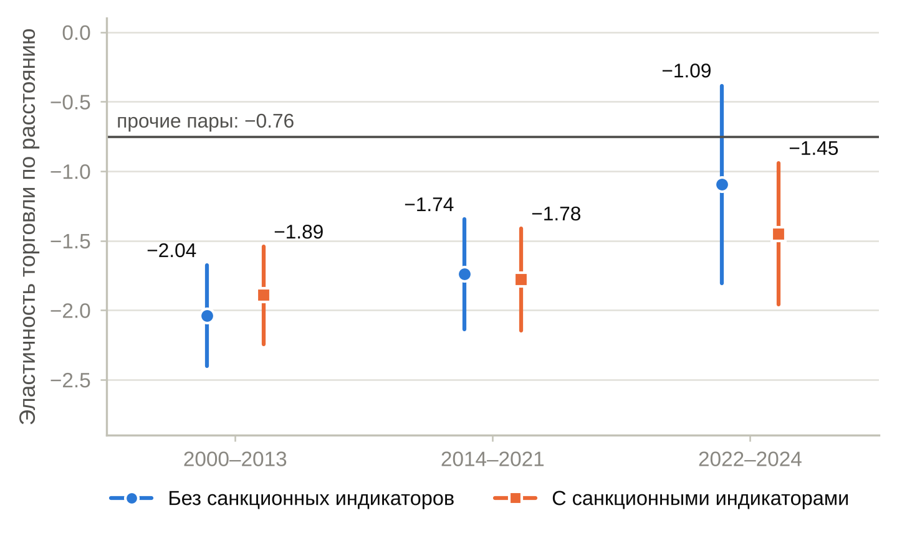
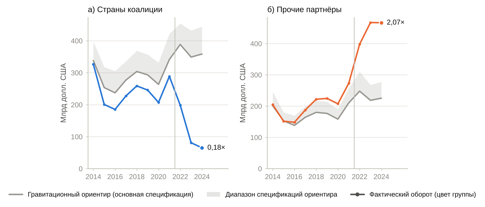
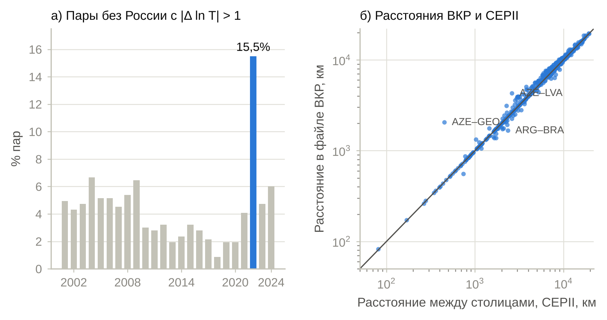
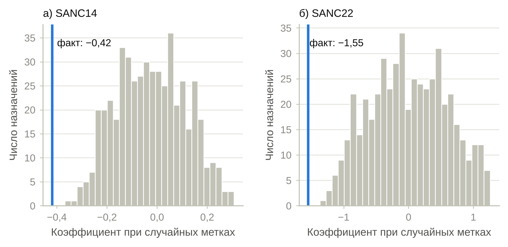

::: {custom-style="Abstract"}
**Аннотация.** Цель работы — количественно оценить влияние санкционных режимов 2014 и 2022 гг. на двусторонние торговые потоки России и показать, как результаты зависят от спецификации гравитационной модели. Эмпирическая основа — панель из 496 пар 32 стран за 2000–2024 гг. Типичная для прикладных работ спецификация (МНК в логарифмах, ВВП на душу населения, «санкционные» индикаторы, не зависящие от пары стран) порождает артефакты: положительный «эффект» санкций 2014 г. (0,107), положительную эластичность по расстоянию и многократное «усиление» торговли внутри БРИКС. Структурная спецификация — PPML с фиксированными эффектами «страна — год» и «пара» и парными индикаторами санкций — даёт устойчиво отрицательные оценки: после 2014 г. торговля России со странами санкционной коалиции сократилась относительно торговли с прочими партнёрами на 34 % (−0,42 лог. пункта), после 2022 г. — ещё на 79 % (−1,55); накопленный относительный эффект составляет 86 %. Анализ динамики не выявляет дифференциальных трендов в 2009–2013 гг., показывает постепенное расхождение в 2014–2021 гг. и обвальное снижение в 2022–2024 гг. Эластичность российской торговли по расстоянию уменьшилась по модулю с −2,04 до −1,09, а средневзвешенная удалённость партнёров выросла с 3,6 до 4,7 тыс. км. Гравитационный ориентир, оценённый по дособытийным данным, показывает, что в 2024 г. торговля с коалицией составила 0,18 ориентира, а с прочими партнёрами — 2,07 ориентира. Выводы устойчивы к перестановочному тесту, исключению отдельных партнёров, смене окна наблюдения и параметрическому бутстрэпу; ограничения связаны с качеством статистики после 2021 г. и симметричной (суммарной) формой торговых потоков.

**Ключевые слова:** гравитационная модель; санкции; внешняя торговля России; PPML; фиксированные эффекты; многосторонние сопротивления; переориентация торговли.

**JEL:** F13, F14, F51, C23, C25.
:::

::: {custom-style="Abstract"}
**Abstract.** The paper quantifies the effect of the 2014 and 2022 sanction regimes on Russia's bilateral trade and shows how the results depend on the gravity specification. We use a panel of 496 country pairs from 32 countries, 2000–2024. A specification typical of applied work (log-linear OLS, GDP per capita, pair-invariant "sanction" dummies) generates artefacts: a positive "effect" of the 2014 sanctions (0.107), a positive distance elasticity and an implausibly large intra-BRICS trade premium. A structural specification — PPML with country-by-year and pair fixed effects and pair-specific sanction indicators — yields robustly negative estimates: after 2014, Russia's trade with the sanctioning coalition fell by 34% relative to its trade with other partners (-0.42 log points), and after 2022 by a further 79% (-1.55); the cumulative relative effect is 86%. The event study shows no differential pre-trends in 2009–2013, a gradual divergence in 2014–2021 and a collapse in 2022–2024. The distance elasticity of Russian trade fell in absolute value from -2.04 to -1.09, and the trade-weighted distance to partners rose from 3.6 to 4.7 thousand km. A gravity benchmark estimated on pre-event data implies that in 2024 trade with the coalition was 0.18 of the benchmark, whereas trade with other partners was 2.07 times the benchmark. The results are robust to a permutation test, leave-one-partner-out estimation, alternative windows and a parametric bootstrap; the main limitations are the quality of trade statistics after 2021 and the symmetric (total) form of trade flows.

**Keywords:** gravity model; sanctions; Russian foreign trade; PPML; fixed effects; multilateral resistance; trade reorientation.
:::

# 1. Введение

За последнее десятилетие внешняя торговля России дважды подверглась шокам, не имевшим прецедентов в новейшей истории страны: введению секторальных и персональных ограничений в 2014 г. вместе с ответными российскими мерами и резкому расширению санкционного режима после февраля 2022 г. Оба эпизода сопровождались сильным и разнонаправленным перераспределением торговых потоков: торговля с большинством стран, присоединившихся к ограничениям, — прежде всего с государствами Европейского союза — сокращалась, тогда как торговля с Китаем, Индией, Турцией и странами Ближнего Востока росла. Однако отделить собственно эффект санкций от динамики цен на энергоносители, валютного курса и общемировой конъюнктуры — непростая эмпирическая задача: сопоставление «до и после» смешивает все эти факторы.

Стандартным инструментом анализа двусторонней торговли служит гравитационная модель. За шесть десятилетий, прошедших после работ Тинбергена [Tinbergen, 1962] и Пёйёнена [Pöyhönen, 1963], она прошла путь от эмпирической регулярности до одной из наиболее обоснованных теоретически конструкций международной экономики [Anderson, 1979; Eaton, Kortum, 2002; Anderson, van Wincoop, 2003; Head, Mayer, 2014; Yotov, 2022]. Вместе с тем в прикладных работах по российской торговле до сих пор распространены спецификации, которые не учитывают многосторонние сопротивления, подменяют экономический размер стран ВВП на душу населения, оценивают логарифмированную модель методом наименьших квадратов и включают «санкционные» переменные, общие для всех пар стран. Такие спецификации не идентифицируют эффект санкций и способны давать парадоксальные результаты — вплоть до положительного «эффекта» ограничений.

Цель работы — измерить влияние санкционных режимов 2014 и 2022 гг. на двусторонние торговые потоки России в рамках структурной гравитационной модели и показать, насколько выводы зависят от спецификации. Мы отвечаем на пять вопросов. (1) Как меняется оценка «санкционного эффекта» при переходе от типичной учебной спецификации к структурной? (2) Каковы величина и динамика относительных эффектов режимов 2014 и 2022 гг. для торговли России со странами санкционной коалиции? (3) Как перераспределилась торговля России, в том числе географически, и одинаково ли это затронуло «прочих» партнёров? (4) Что показывает гравитационный ориентир — оценка торговли, ожидаемой при сохранении дособытийных связей? (5) Насколько результаты устойчивы к недостаткам данных и к способу статистического вывода?

Вклад работы состоит в следующем. Во-первых, мы документируем влияние спецификации на выводы о санкциях, последовательно переходя от традиционной модели к структурной (табл. 1, рис. 2); в частности, показываем, что положительный «эффект» санкций, знак эластичности по расстоянию и многократное «усиление» торговли в БРИКС в исходной спецификации — артефакты. Во-вторых, мы оцениваем парные эффекты обоих санкционных режимов методом PPML с фиксированными эффектами «страна — год» и «пара» по данным до 2024 г., используя в качестве группы сравнения как остальных партнёров России, так и пары, не включающие Россию. В-третьих, мы измеряем географическую переориентацию российской торговли через сдвиг её эластичности по расстоянию. В-четвёртых, мы строим гравитационный ориентир на дособытийных данных и оцениваем его точность на плацебо-выборках. В-пятых, мы проводим и публикуем аудит исходных данных: он выявил дефекты, существенные для любых выводов о 2022–2024 гг.

Структура статьи такова. В разделе 2 дан обзор литературы. Раздел 3 описывает данные и эмпирическую стратегию. В разделе 4 представлены результаты, в разделе 5 — их обсуждение и ограничения. Раздел 6 содержит заключение. Аудит данных, состав групп стран и дополнительные результаты вынесены в приложения.

# 2. Обзор литературы

## 2.1. От эмпирической регулярности к структурной гравитации

В исходной форме гравитационное уравнение связывает двусторонний торговый поток с экономическими «массами» стран и издержками торговли, аппроксимируемыми расстоянием: $T_{ij} = G\,Y_i^{\alpha} Y_j^{\beta} d_{ij}^{-\gamma}$ [Tinbergen, 1962; Pöyhönen, 1963; Linnemann, 1966]. Теоретические основания были заложены в работах [Anderson, 1979; Bergstrand, 1985; Deardorff, 1998] и получили современную форму в [Eaton, Kortum, 2002; Anderson, van Wincoop, 2003]. Ключевой вывод последней работы состоит в том, что двусторонний поток зависит не только от торговых издержек $t_{ij}$ между $i$ и $j$, но и от этих издержек *относительно остального мира* — «многосторонних сопротивлений» $\Pi_i$ и $P_j$:

$$X_{ij} = \frac{Y_i E_j}{Y}\left(\frac{t_{ij}}{\Pi_i P_j}\right)^{1-\sigma}, \qquad \Pi_i^{1-\sigma} = \sum_{j} \left(\frac{t_{ij}}{P_j}\right)^{1-\sigma}\frac{E_j}{Y}, \qquad P_j^{1-\sigma} = \sum_{i} \left(\frac{t_{ij}}{\Pi_i}\right)^{1-\sigma}\frac{Y_i}{Y}, \qquad (1)$$

где $X_{ij}$ — экспорт из $i$ в $j$, $Y_i$ и $E_j$ — выпуск и расходы, $Y$ — мировой выпуск, $\sigma > 1$ — эластичность замещения. Отсюда следуют два практических вывода. Во-первых, пропуск многосторонних сопротивлений приводит к смещению оценок, и именно он отнесён Болдуином и Таглиони к наиболее серьёзным ошибкам прикладных гравитационных работ [Baldwin, Taglioni, 2006]. Во-вторых, многосторонние сопротивления можно учесть, включив в модель фиксированные эффекты экспортёра и импортёра (на панельных данных — в их взаимодействии с годом) [Fally, 2015]. Хед и Майер показали, что структурная гравитация выводится из широкого класса моделей торговли [Head, Mayer, 2014]; Аркаколис и соавторы — что для многих из них следствия для благосостояния близки [Arkolakis et al., 2012]. Современные руководства и обзоры [Yotov et al., 2016; Anderson, 2011; Yotov, 2022] фиксируют «стандартную» практику: оценка в уровнях методом PPML, фиксированные эффекты «страна — год» и «пара», кластеризация ошибок по парам.

## 2.2. Оценивание: нули, гетероскедастичность, фиксированные эффекты и статистический вывод

Сантос Силва и Тенрейро [Santos Silva, Tenreyro, 2006] показали, что МНК по логарифмированной модели при гетероскедастичности даёт несостоятельные оценки (в силу неравенства Йенсена) и не допускает нулевых потоков; они предложили оценивать модель в уровнях методом квазимаксимального правдоподобия Пуассона (PPML). Этот результат подтверждён дальнейшими исследованиями [Santos Silva, Tenreyro, 2011, 2022]. Фалли [Fally, 2015] доказал, что PPML с фиксированными эффектами экспортёра и импортёра согласуется со структурными ограничениями на многосторонние сопротивления. При оценке эффектов торговой политики на панельных данных рекомендуется включать парные фиксированные эффекты: политика (соглашения, ограничения) эндогенна по отношению к неизменным во времени характеристикам пар [Baier, Bergstrand, 2007; Egger, Larch, 2008; Baier et al., 2019]. Недавние работы переносят в гравитационные модели методы оценки «разности разностей» при ступенчатом введении политики: Нагенгаст и Йотов [Nagengast, Yotov, 2025] встраивают расширенную оценку с двусторонними фиксированными эффектами в структурную гравитацию и показывают, что традиционные оценки эффектов торговых соглашений могут быть занижены более чем наполовину. В нашей постановке моменты воздействия общие для всех обработанных пар (2014 и 2022 гг.), поэтому проблема «запрещённых сравнений» между парами с разным временем воздействия не возникает, но анализ динамики эффектов остаётся необходимым.

Вычислительные и статистические аспекты высокоразмерных фиксированных эффектов обсуждаются в [Correia et al., 2020]. В трёхмерных панелях (экспортёр — импортёр — время) возникает проблема «несущественных параметров», и PPML может быть смещён, если число стран невелико [Weidner, Zylkin, 2021]. Для статистического вывода принято кластеризовать ошибки по парам стран [Cameron et al., 2011; Abadie et al., 2023]; для диадных данных предложены оценки, учитывающие зависимость между парами с общей страной [Aronow et al., 2015]. Типичные ошибки прикладных работ — отсутствие многосторонних сопротивлений, усреднение двусторонних потоков, некорректная дефляция — систематизированы в [Baldwin, Taglioni, 2006]. Что касается самой эластичности по расстоянию, мета-анализ Дисдье и Хэда [Disdier, Head, 2008] даёт среднюю оценку около −0,9 и фиксирует её удивительную устойчивость во времени. Базы данных для гравитационного анализа обобщены в [Conte et al., 2022; Mayer, Zignago, 2011; Gaulier, Zignago, 2010].

## 2.3. Экономические санкции и торговля

Классический обзор эффективности санкций [Hufbauer et al., 2007] фиксирует широкий разброс исходов; исторический контекст дан в [Mulder, 2022]. Для количественного анализа санкций создана Global Sanctions Data Base [Felbermayr et al., 2020; Syropoulos et al., 2024]. На её основе показано, что санкции в рамках структурной гравитационной модели значимо сокращают двустороннюю торговлю, причём эффект существенно зависит от типа и полноты ограничений и от направления потока [Felbermayr et al., 2019]; междисциплинарный обзор подходов приведён в [Felbermayr et al., 2021]. Четвёртый выпуск базы, посвящённый режиму санкций против России, использован в [Yalcin et al., 2025]: средние эффекты ограничений на торговлю России со странами-инициаторами отрицательны и статистически значимы, но сравнительно невелики и сильно различаются между странами-инициаторами (в том числе внутри ЕС); оценки указывают также на снижение прямых торговых издержек России в торговле с Индией, Китаем и Турцией, которое может компенсировать эффект западных санкций. Теоретический анализ адресных санкций дан в [Ahn, Ludema, 2020]; влияние санкций на экономический рост — в [Neuenkirch, Neumeier, 2015].

## 2.4. Россия: режимы 2014 и 2022 гг., переориентация торговли

Для эпизода 2014 г. наиболее близка к нашей работа [Crozet, Hinz, 2020], в которой на данных по товарным позициям оцениваются торговые последствия санкций и ответных мер: потери России за 2014–2015 гг. оценены в 7,4 % прогнозного экспорта, потери стран-инициаторов — в 0,3 % их экспорта, причём основная часть последних пришлась на товары, не затронутые российским ответным эмбарго («дружественный огонь»), что авторы связывают прежде всего с ростом странового риска в операциях с Россией, а не с изменением предпочтений российских потребителей. Данные на уровне фирм использованы в [Crozet et al., 2021]; потери российских потребителей от продовольственного эмбарго оценены в [Hinz, Monastyrenko, 2022]. Макроэкономические эффекты 2014 г. — финансовые ограничения, курс рубля, рост — рассматривались в [Gurvich, Prilepskiy, 2015; Dreger et al., 2016; Kholodilin, Netšunajev, 2019; Korhonen et al., 2018]; российская гравитационная литература включает обзор подходов к оцениванию [Шумилов, 2017], проверку гипотезы Линдера [Смирнов, 2020] и оценку влияния индекса свободы торговли [Упатина, 2021].

Для эпизода 2022 г. накоплена быстро растущая литература: влияние санкций на валютный курс [Itskhoki, Mukhin, 2022], на экспорт нефти и его перенаправление в Азию [Babina et al., 2023], на экономику стран-инициаторов [Bachmann et al., 2022]. Отдельная линия исследований, использующая товарные и транзакционные данные, посвящена замещению и перенаправлению торговли. В [Chupilkin et al., 2026] показано, что поставки в Россию из стран, введших ограничения, частично перенаправлялись через страны Кавказа и Центральной Азии; в [Chupilkin et al., 2025] на данных о транзакциях и торговых марках установлено, что значительная часть импорта товаров «западных» марок перенаправлялась через посредников в нейтральных странах, однако компенсировала лишь часть падения прямых поставок. По данным [Egorov et al., 2025], импорт санкционных товарных позиций в Россию после начала войны сократился более чем наполовину, а с учётом перенаправления через третьи страны суммарный импорт этих товаров снизился примерно на 30 %; в [Sjöholm, 2026] показано, что прирост прямого китайского экспорта в Россию был наибольшим в товарных линиях, где она сильнее зависела от поставок из ЕС, при этом значимая часть замещения шла через Гонконг, Армению, Казахстан, Киргизию и Турцию. Гравитационные оценки для России на агрегированных данных по-прежнему редки: в [Izotov, 2025] на данных за 1995–2024 гг. показано, что переориентация торговли на страны — члены ВТО и восстановление мировой торговли компенсировали значительную часть ущерба от западных санкций, тогда как вклад интеграционных соглашений был меньше. Более широкий контекст — геоэкономическая фрагментация: согласно [Aiyar et al., 2023; Gopinath et al., 2025; Campos et al., 2023], торговые и инвестиционные потоки всё сильнее зависят от геополитической близости; сопоставимые процессы — «перераспределение» цепочек поставок [Alfaro, Chor, 2023], торговая война США и Китая [Fajgelbaum, Khandelwal, 2022] и «френд-шоринг» [Javorcik et al., 2022]. Для российской торговли значимы также участие в ВТО и интеграция в рамках ЕАЭС [Lissovolik, Lissovolik, 2006; Tarr, 2016].

## 2.5. Пробелы в литературе и вклад настоящей работы

Из обзора следует, что (i) структурная гравитационная методология хорошо разработана, но (ii) в прикладных работах по России её требования нередко не соблюдаются, а (iii) для обоих санкционных эпизодов не хватает сопоставимых структурных оценок на едином панельном наборе данных, доведённом до 2024 г., с явной группой сравнения и анализом динамики (наиболее близкая по духу работа [Yalcin et al., 2025] опирается на базу санкций и оценивает гетерогенные эффекты по странам-инициаторам; наш акцент — на сопоставлении спецификаций, динамике эффектов по годам и географии переориентации торговли). Кроме того, (iv) географический аспект переориентации — изменение чувствительности российской торговли к расстоянию — до сих пор оценивался преимущественно описательно, а (v) качество статистики о российской торговле после 2021 г. редко становится предметом самостоятельного аудита. Настоящая работа восполняет эти пробелы.

# 3. Данные и эмпирическая стратегия

## 3.1. Данные

**Выборка.** Анализ опирается на сбалансированную панель из 32 стран (Россия и 31 партнёр; состав — в приложении Б), 496 неупорядоченных пар и 25 лет (2000–2024), всего 12 400 наблюдений. Партнёры, вошедшие в выборку, обеспечивают около трёх четвертей российского внешнеторгового оборота: в 2024 г. оборот России с ними по данным панели составил 532 млрд долл. против 716,9 млрд долл. по данным Федеральной таможенной службы. Выборка составлена по критерию полноты рядов, поэтому она может быть смещена в сторону стран со стабильной отчётностью и недопредставляет Европейский союз (8 из 27 государств); эти ограничения обсуждаются в разделе 5.

**Торговля.** Зависимая переменная $T_{ijt}$ — суммарный двусторонний товарооборот (сумма экспорта и импорта стран $i$ и $j$) в текущих долларах США по данным UN Comtrade; перечень партнёров и их коды приведены в приложении Б. Использование суммарной, а не направленной торговли накладывает ограничение (раздел 3.2); оно связано с тем, что исходный набор содержит только суммарные потоки.

**Экономический размер и расстояние.** ВВП $Y_{it}$ и численность населения берутся из World Development Indicators (2000–2023; текущие цены, зеркало данных Всемирного банка); для 2024 г. ВВП рассчитан как произведение оценки МВФ (WEO) ВВП на душу населения на численность населения WDI. Расстояние $d_{ij}$ — население-взвешенное расстояние между странами (CEPII GeoDist, показатель *distw*, км) [Mayer, Zignago, 2011]; из той же базы взяты общая граница, общий официальный язык и принадлежность к единому государству в прошлом (СССР). Дамми членства в ЕС, НАТО, БРИКС, ВТО и Таможенном союзе/ЕАЭС кодируются как «обе страны — члены» с учётом дат вступления (приложение В).

**Санкционные индикаторы.** Группу «ядро коалиции 2014 г.» образуют страны выборки, введшие ограничительные меры в 2014 г.: восемь государств ЕС (Эстония, Финляндия, Франция, Германия, Италия, Латвия, Литва, Польша), Великобритания (как член ЕС в 2014 г.), США, Канада, Австралия, Япония и Норвегия. В 2022 г. к ним присоединилась Республика Корея. Украина выделена в отдельную группу: на её торговлю с Россией помимо санкционных мер влияют военные действия. Остальные 15 партнёров (Аргентина, Азербайджан, Беларусь, Бразилия, Китай, Египет, Грузия, Индия, Индонезия, Казахстан, Мексика, Саудовская Аравия, ЮАР, Турция, ОАЭ) не присоединялись к ограничениям. Группы близки к перечню государств, совершающих недружественные действия, утверждённому распоряжением Правительства РФ от 05.03.2022 № 430-р, и к составу стран, на которые распространялось продовольственное эмбарго 2014 г. (указ Президента РФ от 06.08.2014 № 560); различия существенны только для Японии, не входившей в круг стран эмбарго, и Республики Кореи. Индикаторы определены на уровне *пары*:

$$\text{SANC}^{14}_{ijt} = \text{CORE}_{ij}\cdot\mathbb{1}[t \ge 2014], \qquad \text{SANC}^{22}_{ijt} = \text{CORE}_{ij}\cdot\mathbb{1}[t \ge 2022], \qquad (2)$$

где $\text{CORE}_{ij} = 1$, если одна из стран пары — Россия, а другая принадлежит ядру коалиции. Аналогично определены $\text{KOR}_{ijt}$ (Россия — Республика Корея, $t \ge 2022$) и $\text{UKR}^{14}_{ijt}$, $\text{UKR}^{22}_{ijt}$ (Россия — Украина). Принципиально, что эти переменные не равны единице для всех пар при $t \ge 2014$ или $t \ge 2022$: временные индикаторы такого рода поглощаются годовыми эффектами и не несут информации о санкциях.

**Аудит исходных данных.** Исходная панель, собранная для учебного исследования, была проверена на согласованность (приложение А). Выявлено шесть групп дефектов. (i) «Санкционные» индикаторы исходного набора равны единице для всех 496 пар начиная с 2014 и с 2022 г., т. е. являются временными дамми. (ii) Расстояния исходного набора у 89 пар отличаются от расстояний между столицами CEPII более чем на 10 % (например, Азербайджан — Грузия: 2063 км вместо 451 км). (iii) Дамми БРИКС за 2024 г. содержит три ошибки (лишние пары Аргентины с Египтом и ОАЭ, пропущена пара Россия — ОАЭ), дамми НАТО в 2000–2003 гг. пропускает пару Норвегия — Польша. (iv) Для 29 пар значение торговли 2024 г. совпадает со значением 2023 г. (протянуто без обновления), для 2 пар — значение 2023 г. совпадает с 2022 г. (v) В 2022 г. доля пар без России с изменением торговли более чем в $e \approx 2{,}7$ раза составила 15,5 % против 1,9 % в 2019 г.; такие скачки сосредоточены в парах с ОАЭ, а также в ряде пар (Канада — Китай, Франция — Италия), и свидетельствуют о неполноте отчётности одной из сторон. (vi) Ряды ВВП на душу населения за 2000–2021 гг. взяты из Всемирного банка, за 2022–2024 гг. — из МВФ. Дефекты (i)–(iii) и (vi) исправлены; дефекты (iv)–(v) устранить без первичных данных нельзя, поэтому все основные результаты сопровождаются проверкой устойчивости к исключению помеченных наблюдений и «проблемных» партнёров (раздел 4.8).

## 3.2. Эмпирическая стратегия

**Традиционная спецификация.** Для сопоставимости с практикой прикладных работ оценивается модель

$$T_{ijt} = \exp\Big(\beta_0 + \beta_1 \ln(Y_{it}Y_{jt}) + \beta_2\big|\ln y_{it}-\ln y_{jt}\big| + \beta_3 \ln d_{ij} + \boldsymbol{\gamma}^{\top}\mathbf{x}_{ij} + \boldsymbol{\delta}^{\top}\mathbf{P}_{ijt} + \tau_t\Big)\,\varepsilon_{ijt}, \qquad (3)$$

где $y_{it}$ — ВВП на душу населения, $\mathbf{x}_{ij}$ — общая граница, язык и бывшее единое государство, $\mathbf{P}_{ijt}$ — вектор политических индикаторов (раздел 3.1, формула (2) и далее), $\tau_t$ — годовые эффекты. Так как суммарная торговля симметрична, а ориентация пары (какая страна обозначена $i$, а какая $j$) произвольна, показатели размера входят симметрично: в виде суммы логарифмов ВВП и модуля разности логарифмов подушевых ВВП (последний проверяет гипотезу Линдера [Linder, 1961]). Эта спецификация отражает «традиционную» практику: многосторонние сопротивления не учитываются, а эффекты политики идентифицируются главным образом за счёт межпарной вариации.

**Структурная спецификация.** Основная модель —

$$T_{ijt} = \exp\Big(\alpha_{it} + \alpha_{jt} + \eta_{ij} + \boldsymbol{\delta}^{\top}\mathbf{P}_{ijt}\Big)\,\varepsilon_{ijt}, \qquad \mathrm{E}[\varepsilon_{ijt}\mid\cdot] = 1, \qquad (4)$$

где $\alpha_{it}$ — эффекты «страна — год» (поглощают размер экономики, многосторонние сопротивления, валютные и ценовые шоки на уровне страны), $\eta_{ij}$ — парные эффекты (поглощают неизменные во времени двусторонние издержки — расстояние, границу, язык, историю), $\mathbf{P}_{ijt}$ — индикаторы санкций и политики. Оценивание — PPML [Santos Silva, Tenreyro, 2006]. Формула (4) выводится из структурной гравитации (1) при двух допущениях: симметрии двусторонних издержек и совпадении эффектов экспортёра и импортёра страны в данном году (последнее верно при сбалансированной торговле); тогда сумма встречных потоков $X_{ij}+X_{ji}$ имеет мультипликативный вид с единым эффектом страны. Нарушение этих допущений — главное концептуальное ограничение работы; поэтому все оценки относятся к *товарообороту*, а не к экспорту и импорту по отдельности.

**Идентификация.** Параметры $\boldsymbol{\delta}$ в (4) идентифицируются изменением торговли пар «Россия — страна коалиции» относительно (а) торговли той же России с остальными партнёрами (за счёт эффектов $\alpha_{\text{RUS},t}$ в формуле (4) все общероссийские шоки — цена нефти, курс рубля, общий эффект санкций на экономику России — поглощены) и (б) торговли тех же стран коалиции с остальным миром (эффекты $\alpha_{jt}$). Это оценка типа «разность разностей разностей»; её каузальная интерпретация требует, чтобы в отсутствие санкций торговля России с коалицией и с остальными партнёрами эволюционировала параллельно (с поправкой на $\alpha_{it}$ и $\eta_{ij}$). Условие проверяется анализом динамики (event study):

$$T_{ijt} = \exp\Big(\alpha_{it} + \alpha_{jt} + \eta_{ij} + \sum_{\tau \ne 2013}\theta_\tau\,\text{CORE}_{ij}\,\mathbb{1}[t=\tau] + \boldsymbol{\delta}_{-}^{\top}\mathbf{P}^{-}_{ijt}\Big)\,\varepsilon_{ijt}, \qquad (5)$$

в котором $\theta_\tau$ для $\tau < 2014$ должны быть близки к нулю, а 2013 г. служит базой. Важно подчеркнуть, что из-за эффектов $\alpha_{\text{RUS},t}$ оценки идентифицируют лишь *относительные* эффекты (коалиция по сравнению с остальными партнёрами); оценить абсолютное влияние санкций на всю торговлю России в такой постановке нельзя, поскольку оно поглощается общероссийскими эффектами. Поэтому мы дополняем анализ гравитационным ориентиром (формула (7)).

**Градиент расстояния.** Чтобы измерить географическую переориентацию, в модель вводится взаимодействие логарифма расстояния с российскими парами. В версии без парных эффектов эластичность российской торговли по расстоянию в периоде $p$ равна $\beta_3 + \kappa_p$:

$$T_{ijt} = \exp\Big(\alpha_{it}+\alpha_{jt} + \beta_3\ln d_{ij} + \sum_{p}\kappa_p\,\ln d_{ij}\,\text{RUS}_{ij}\,\mathbb{1}[t\in\mathcal{T}_p] + \boldsymbol{\gamma}^{\top}\mathbf{x}_{ij} + \boldsymbol{\delta}^{\top}\mathbf{P}_{ijt}\Big)\,\varepsilon_{ijt}, \qquad (6)$$

где $\mathcal{T}_1 = \{2000,\dots,2013\}$, $\mathcal{T}_2 = \{2014,\dots,2021\}$, $\mathcal{T}_3 = \{2022,\dots,2024\}$. В версии с парными эффектами идентифицируются только *сдвиги* градиента после 2014 и 2022 гг. (коэффициенты при $\widetilde{\ln d}_{ij}\,\text{RUS}_{ij}\,\mathbb{1}[t\ge 2014]$ и $\mathbb{1}[t\ge 2022]$, где $\widetilde{\ln d}_{ij}$ — логарифм расстояния, центрированный по российским партнёрам).

**Гравитационный ориентир.** Чтобы получить абсолютные величины, оценивается модель с парными и годовыми эффектами и ВВП на выборке $\mathcal{S}_{t_0}$, включающей все пары до года отсечения $t_0$ и только пары *без России* после него:

$$\widehat{T}_{ijt} = \exp\Big(\hat\eta_{ij} + \hat\tau_t + \hat\beta\,\ln(Y_{it}Y_{jt}) + \hat{\boldsymbol{\gamma}}^{\top}\mathbf{z}_{ijt}\Big), \qquad R_{gt} = \frac{\sum_{ij\in g}T_{ijt}}{\sum_{ij\in g}\widehat{T}_{ijt}}, \qquad (7)$$

где $\mathbf{z}_{ijt}$ — индикаторы членства (ЕС, ВТО, ЕАЭС, НАТО, БРИКС), $g$ — группа российских пар. Годовые эффекты $\hat\tau_t$ после $t_0$ определяются по парам без России и отражают общемировую динамику торговли; парные эффекты российских пар — по данным до $t_0$. Ориентир показывает торговлю, ожидаемую при сохранении дособытийных связей и фактической динамике ВВП. Основной вариант: $t_0 = 2013$, окно оценивания 2009–2024 гг.; альтернативы — окно 2000–2024 гг. и модель без ВВП. Точность ориентира оценивается на плацебо-выборках: $t_0 = 2008$ (окно 2000–2024) и $t_0 = 2010$ (окно 2005–2024), для которых известно, что санкций не было.

**Статистический вывод.** Стандартные ошибки кластеризуются по парам стран. Поскольку «обработанных» российских пар лишь 14, дополнительно применяются: (а) диадно-робастные ошибки [Aronow et al., 2015], допускающие произвольную зависимость между всеми парами с общей страной (отрицательные собственные значения оценки ковариационной матрицы заменяются нулями); (б) перестановочный тест — метка «коалиция» случайно присваивается 14 из 29 российских партнёров (кроме Украины и Республики Кореи) (500 назначений); (в) параметрический бутстрэп для оценки смещения от «несущественных параметров» [Weidner, Zylkin, 2021] и фактического покрытия доверительных интервалов (200 повторений); (г) исключение каждого российского партнёра поочерёдно. Оценки получены собственной реализацией PPML с разреженными эффектами «страна — год» и «пара» (код в репозитории); реализация проверена на `pyfixest.fepois` (расхождение коэффициентов менее $10^{-9}$) и на команде `poisson` пакета gretl 2023c (совпадение до четвёртого знака).

# 4. Результаты

## 4.1. Описательная картина

Рис. 1 показывает масштаб и структуру изменений. Торговля России с партнёрами выборки выросла с 108 млрд долл. в 2000 г. до 600 млрд долл. в 2012 г., упала до 344 млрд долл. в 2016 г., восстановилась до 574 млрд долл. в 2021 г. и составила 532 млрд долл. в 2024 г. Доля стран коалиции, равная 65 % в 2000 г. и 60 % в 2013 г., снизилась до 50 % к 2021 г. и до 12 % в 2024 г. Средневзвешенное (по обороту) расстояние до партнёров увеличилось с 3,6 тыс. км в 2000 г. до 3,8 тыс. км в 2013 г., 4,3 тыс. км в 2021 г. и 4,7 тыс. км в 2024 г. Эти факты описательны: они не отделяют эффект санкций от динамики цен на энергоносители, валютного курса и общемировых шоков; для этого необходима структурная модель.

{width=15.5cm}

## 4.2. От традиционной спецификации к структурной

Табл. 1 последовательно переходит от исходной («учебной») спецификации к структурной. Столбец (1) воспроизводит исходную пулированную регрессию МНК с ВВП на душу населения, ориентацией пар по алфавиту и временными дамми «санкций». Она даёт положительный и значимый «эффект» санкций 2014 г. (0,107), положительную эластичность по расстоянию (0,096) и гигантские эффекты общей границы (2,300, т. е. рост торговли в 10,0 раза), членства в БРИКС (2,952, или в 19,2 раза) и в НАТО (0,733, в 2,1 раза). Эти результаты — следствие спецификации, а не свойство данных. Во-первых, переменные «санкций» равны единице для всех пар после 2014 и 2022 гг. и фиксируют лишь общую динамику мировой торговли. Во-вторых, вместо экономического размера используется ВВП на душу населения, поэтому «размерный» эффект крупных по населению стран (Китай, Индия, Бразилия, США) приписывается дамми БРИКС и НАТО. В-третьих, расстояния исходного набора содержат ошибки, а многосторонние сопротивления не учтены. В-четвёртых, сравнение коэффициентов при ВВП на душу населения «страны $i$» и «страны $k$», которое обычно используется для вывода о том, чей рост влияет сильнее, лишено смысла: порядок стран в паре произволен, и различие коэффициентов отражает лишь состав пар.

Table: Таблица 1 — Спецификационный путь: ключевые коэффициенты (зависимая переменная — $T_{ijt}$; в МНК — $\ln T_{ijt}$). В скобках — стандартные ошибки, кластеризованные по парам. ЭФ — фиксированные эффекты. Столбец (1): коэффициенты при «SANC14» и «SANC22» — это временные дамми исходной модели (равны единице для всех пар при $t \ge 2014$ и $t \ge 2022$). * p < 0,10; ** p < 0,05; *** p < 0,01.

| Переменная | (1) ВКР: МНК (модель 4) | (2) МНК, ln T, год. ЭФ | (3) PPML, год. ЭФ | (4) PPML, страновые + год. ЭФ | (5) PPML, страна×год ЭФ | (6) PPML, страна×год + парные ЭФ |
|:------------------------|:------------:|:------------:|:------------:|:--------------:|:-------------:|:---------------:|
| ln(ВВП_i) + ln(ВВП_j) |  | 0,943*** (0,019) | 0,856*** (0,028) | 0,573*** (0,046) |  |  |
| \|ln(ВВП п/д_i) − ln(ВВП п/д_j)\| |  | −0,170*** (0,041) | −0,009 (0,053) | −0,022 (0,046) |  |  |
| ln ВВП п/д страны i (ВКР) | 0,336*** (0,018) |  |  |  |  |  |
| ln ВВП п/д страны j (ВКР) | 0,819*** (0,018) |  |  |  |  |  |
| ln расстояние | 0,096*** (0,027) | −1,242*** (0,067) | −0,745*** (0,071) | −0,786*** (0,075) | −0,786*** (0,079) |  |
| Общая граница | 2,300*** (0,090) | 0,988*** (0,206) | 0,811*** (0,147) | 0,625*** (0,133) | 0,645*** (0,136) |  |
| Общий офиц. язык |  | 0,497*** (0,135) | 0,095 (0,120) | 0,021 (0,152) | 0,005 (0,155) |  |
| Бывшая единая страна |  | 0,379 (0,393) | 0,241* (0,142) | −0,408 (0,251) | −0,434* (0,258) |  |
| ЕС (обе страны) | 0,219** (0,102) | −0,079 (0,158) | −0,262 (0,190) | 0,135 (0,143) | 0,107 (0,168) | 0,158** (0,075) |
| ВТО (обе страны) |  | 0,504*** (0,125) | 0,157 (0,101) | 0,270*** (0,072) | 1,046*** (0,273) | 0,137 (0,087) |
| ЕАЭС/ТС (обе страны) |  | 1,519*** (0,575) | 1,168** (0,533) | 1,673*** (0,407) | 1,683*** (0,417) | −0,281*** (0,107) |
| НАТО (обе страны) | 0,733*** (0,074) | −0,445*** (0,092) | −0,305*** (0,112) | −0,042 (0,149) | −0,012 (0,136) | 0,019 (0,226) |
| БРИКС (обе страны) | 2,952*** (0,174) | 0,322 (0,294) | −0,418 (0,474) | −0,215 (0,362) | −0,271 (0,432) | 0,118 (0,154) |
| Пара с Россией |  | −0,153 (0,219) | −0,054 (0,327) |  |  |  |
| Россия × коалиция (уровень) |  | 0,495* (0,275) | −0,064 (0,365) | 0,332 (0,360) | 0,451 (0,344) |  |
| Россия × Украина (уровень) |  | 1,619*** (0,237) | 1,158*** (0,324) | 1,455*** (0,340) | 1,400*** (0,328) |  |
| SANC14: Россия × коалиция × (t ≥ 2014) | 0,107** (0,045) | −0,787*** (0,145) | −0,303*** (0,115) | −0,394*** (0,072) | −0,403*** (0,147) | −0,322*** (0,088) |
| SANC22: Россия × коалиция × (t ≥ 2022) | −0,112* (0,067) | −1,447*** (0,263) | −1,072*** (0,138) | −1,077*** (0,128) | −1,525*** (0,184) | −1,535*** (0,183) |
| Россия × Респ. Корея × (t ≥ 2022) |  | 0,094 (0,206) | 0,153 (0,225) | −0,458* (0,248) | −0,948*** (0,315) | −0,899*** (0,171) |
| Россия × Украина × (t ≥ 2014) |  | −1,275*** (0,106) | −0,738*** (0,092) | −0,925*** (0,059) | −0,597*** (0,185) | −0,786*** (0,075) |
| Россия × Украина × (t ≥ 2022) |  | −4,428*** (0,045) | −3,237*** (0,049) | −3,204*** (0,046) | −4,227*** (0,321) | −4,169*** (0,314) |
| Число наблюдений | 12400 | 12400 | 12400 | 12400 | 12400 | 12400 |
| Псевдо-R² | 0,267 | 0,820 | 0,870 | 0,926 | 0,946 | 0,992 |
| Кластеры (пары) | — | 496 | 496 | 496 | 496 | 496 |

Замена показателей размера, расстояния и политических индикаторов (столбец 2) возвращает коэффициенты в диапазон, типичный для гравитационной литературы: эластичность по совокупному размеру экономик равна 0,94 в МНК и 0,86 в PPML (теория предсказывает значение, близкое к единице), а эластичность по расстоянию — −1,24 и −0,75 соответственно, что соответствует мета-анализу [Disdier, Head, 2008] для PPML и традиционно более высокому по модулю значению для МНК. Гипотеза Линдера [Linder, 1961] не подтверждается в PPML: оценка при модуле разности подушевых ВВП равна −0,01 и статистически незначима, тогда как в МНК она отрицательна и значима (−0,17). Эффекты БРИКС и НАТО в столбцах (3)–(5) незначимы или отрицательны (БРИКС — −0,42 в столбце 3 и −0,27 в столбце 5; НАТО — −0,30 и −0,01): «преимущество» БРИКС в исходной модели — результат опущенного размера экономик. Переход от МНК к PPML резко меняет и оценки санкционных индикаторов (−0,79 против −0,30), что согласуется с выводом о смещении МНК при гетероскедастичности [Santos Silva, Tenreyro, 2006].

Введение эффектов «страна — год» (столбец 5) переводит анализ в рамки структурной гравитации: эластичность по расстоянию −0,79, общая граница увеличивает торговлю на 91 % (0,64), общий официальный язык значимого эффекта не даёт, а совместное членство в ВТО (1,05) и в ЕАЭС/Таможенном союзе (1,68) оказывается значимым, но лишь за счёт межпарной вариации: после добавления парных эффектов (столбец 6) первый коэффициент теряет значимость (0,14), а второй меняет знак (−0,28). Парные санкционные индикаторы устойчиво отрицательны во всех столбцах (2)–(6); оценки для режима 2014 г. находятся в диапазоне от −0,30 до −0,79, для режима 2022 г. — от −1,07 до −1,53 (рис. 2). Добавление парных эффектов (столбец 6) устраняет влияние неизменных характеристик пар и даёт −0,32 и −1,53.

{width=15.5cm}

## 4.3. Основные оценки

В предпочтительной спецификации (табл. 2, столбец 2; окно 2009–2024 гг.; 7 936 наблюдений) коэффициент при $\text{SANC}^{14}$ равен −0,42 (ст. ошибка 0,060). Это означает, что после 2014 г. торговля пар «Россия — страна ядра коалиции» сократилась на 34 % относительно торговли России с остальными партнёрами и торговли самих стран коалиции с остальным миром. Коэффициент при $\text{SANC}^{22}$, измеряющий дополнительный эффект эскалации 2022 г., составляет −1,55 (ст. ошибка 0,182), т. е. дополнительное снижение на 79 %; суммарный эффект двух режимов к 2022–2024 гг. — −1,97 (ст. ошибка 0,20), или снижение на 86 % (95 %-й доверительный интервал: от −91 % до −79 %). Торговля России с Республикой Корея, присоединившейся в 2022 г., упала на 62 % (−0,97); торговля с Украиной — на 55 % после 2014 г. (−0,79) и ещё на 98 % после 2022 г. (−4,19). Коэффициенты для Республики Кореи и Украины основаны на одной российской паре каждый и не допускают кластерного вывода (раздел 4.8); они приводятся как описательные.

Table: Таблица 2 — Основные оценки PPML (эффекты «страна — год» и «пара»). Зависимая переменная — $T_{ijt}$ (в столбце 7 — $\ln T_{ijt}$, МНК). В скобках — стандартные ошибки, кластеризованные по парам. Пустые ячейки — переменная не включена или поглощена фиксированными эффектами. * p < 0,10; ** p < 0,05; *** p < 0,01.

| Переменная | (1) 2000–2024 | (2) 2009–2024 (основная) | (3) 2009–2021 | (4) 2014 — переходный год | (5) «чистая» выборка | (6) 2000–2024, пре-тренд | (7) МНК ln T |
|:---------------------|:-----------:|:------------:|:----------:|:------------:|:-----------:|:------------:|:-----------:|
| SANC14: Россия × коалиция × (t ≥ 2014) | −0,322*** (0,088) | −0,419*** (0,060) | −0,405*** (0,055) |  | −0,412*** (0,057) | −0,509*** (0,057) | −0,536*** (0,085) |
| Россия × коалиция × (t = 2014) |  |  |  | −0,177*** (0,062) |  |  |  |
| SANC14': Россия × коалиция × (t ≥ 2015) |  |  |  | −0,460*** (0,065) |  |  |  |
| SANC22: Россия × коалиция × (t ≥ 2022) | −1,535*** (0,183) | −1,548*** (0,182) |  | −1,506*** (0,184) | −1,490*** (0,213) | −1,533*** (0,183) | −1,856*** (0,321) |
| Россия × Респ. Корея × (t ≥ 2022) | −0,899*** (0,171) | −0,972*** (0,161) |  | −0,973*** (0,161) | −0,931*** (0,191) | −0,871*** (0,171) | −0,811*** (0,241) |
| Россия × Украина × (t ≥ 2014) | −0,786*** (0,075) | −0,791*** (0,051) | −0,774*** (0,043) | −0,788*** (0,052) | −0,775*** (0,050) | −0,760*** (0,076) | −0,756*** (0,081) |
| Россия × Украина × (t ≥ 2022) | −4,169*** (0,314) | −4,186*** (0,311) |  | −4,188*** (0,312) | −4,152*** (0,325) | −4,168*** (0,314) | −4,989*** (0,300) |
| ЕС (обе страны) | 0,158** (0,075) | 0,145* (0,082) | 0,180** (0,070) | 0,146* (0,082) | 0,138 (0,089) | 0,163** (0,075) | −0,017 (0,138) |
| ВТО (обе страны) | 0,137 (0,087) | 0,100 (0,103) | −0,114 (0,087) | 0,097 (0,103) | −0,012 (0,102) | 0,077 (0,074) | −0,177 (0,129) |
| ЕАЭС/ТС (обе страны) | −0,281*** (0,107) | −0,160** (0,066) | −0,144** (0,062) | −0,161** (0,066) | −0,199*** (0,074) | −0,173 (0,110) | 0,013 (0,235) |
| НАТО (обе страны) | 0,019 (0,226) | −0,103 (0,319) |  | −0,103 (0,319) | −0,114 (0,319) | 0,039 (0,228) | −0,250 (0,381) |
| БРИКС (обе страны) | 0,118 (0,154) | −0,037 (0,343) | 0,311*** (0,120) | −0,037 (0,343) | −0,078 (0,251) | 0,172 (0,152) | −0,254 (0,293) |
| Пре-тренд коалиции, min(t, 2013) − 2013 |  |  |  |  |  | 0,051*** (0,017) |  |
| Число наблюдений | 12400 | 7936 | 6448 | 7936 | 6945 | 12400 | 7936 |
| Псевдо-R² | 0,992 | 0,992 | 0,998 | 0,992 | 0,993 | 0,992 | 0,958 |
| Кластеры (пары) | 496 | 496 | 496 | 496 | 435 | 496 | 496 |

Оценки устойчивы к спецификации. В расширенном окне 2000–2024 гг. (столбец 1) они равны −0,32 и −1,53; для эпизода 2014 г. в окне 2009–2021 гг. (столбец 3) — −0,40. Если выделить 2014 г. в отдельный «переходный» год (столбец 4), эффект в 2014 г. составляет −0,18, а в 2015 г. и позже — −0,46: основная часть изменений приходится на 2015 г. и позднее. При исключении помеченных наблюдений и «проблемных» партнёров (Беларусь, ОАЭ; столбец 5) оценки практически не меняются (−0,41 и −1,49). Поправка на линейный пре-тренд в длинной выборке (столбец 6) увеличивает оценку для 2014 г. до −0,51 при положительном пре-тренде 0,051 в год. Оценки МНК в логарифмах (столбец 7) заметно больше по модулю (−0,54 и −1,86); различие того же типа, что и в табл. 1, и, по аргументу [Santos Silva, Tenreyro, 2006], указывает на смещение МНК при гетероскедастичности. При поочерёдном исключении каждого из российских партнёров оценка $\text{SANC}^{14}$ остаётся в диапазоне от −0,45 до −0,38, а $\text{SANC}^{22}$ — от −1,64 до −1,45. Среди контрольных переменных слабо значимо положительно членство в ЕС (0,15; в окне 2009–2024 гг. эта оценка идентифицируется исключительно выходом Великобритании из ЕС), а участие в ЕАЭС имеет отрицательный знак (−0,16); эффекты НАТО и БРИКС при парных эффектах идентифицируются лишь несколькими изменениями состава (вступление ЮАР в БРИКС в 2011 г., Финляндии в НАТО в 2023 г., Египта и ОАЭ в БРИКС в 2024 г.) и в основной спецификации статистически не отличимы от нуля.

## 4.4. Динамика: event study и подгруппы

Рис. 3 (а) показывает коэффициенты $\theta_\tau$ из формулы (5) для 2000–2024 гг. (база — 2013 г.). В 2000–2004 гг. они отрицательны и значимы (в среднем −0,54 в 2000–2003 гг.) и затем постепенно приближаются к нулю к 2009 г.: торговля России с будущими странами коалиции росла быстрее, чем с остальными партнёрами, — «догоняющий» рост, который можно связать со вступлением Прибалтики и Польши в ЕС, ростом энергетического экспорта и подготовкой к вступлению в ВТО (причинная интерпретация этих факторов в работе не проверялась). Совместный тест на равенство нулю опережающих коэффициентов 2000–2012 гг. отвергается (χ²(13) = 45,1, p < 0,001), поэтому длинное «дособытийное» окно не удовлетворяет условию параллельных трендов. В окне 2009–2013 гг. дифференциального тренда нет: совместный тест для четырёх опережающих коэффициентов даёт χ²(4) = 2,54, p = 0,64. Это и обосновывает выбор окна 2009–2024 гг. как основного.

После 2013 г. коэффициенты убывают постепенно: −0,14 в 2014 г., −0,31 в 2015 г., −0,40 в 2016 г., −0,47 в 2018 г. и −0,52 в 2021 г. Затем следует обвал: −1,25 в 2022 г., −2,41 в 2023 г. и −2,61 в 2024 г., что соответствует снижению на 93 % относительно уровня 2013 г. Постепенность спада в 2014–2021 гг. указывает на то, что эффект режима 2014 г. определялся не единовременным шоком, а нарастанием ограничений (секторальные меры, ответное эмбарго, замещение импорта), тогда как режим 2022 г. привёл к скачкообразному разрыву связей. Торговля с Украиной (рис. 3 б) сокращалась с 2014 г. и практически прекратилась в 2022–2024 гг.

{width=15.5cm}

Табл. 3 (А) и рис. 4 раскрывают состав эффекта. В первом эпизоде снижение наиболее сильно в ЕС-8 (−0,51, или −40 %), существенно слабее для группы «США, Канада, Австралия, Великобритания» (−0,23) и для Японии и Норвегии (−0,18). Гипотеза о равенстве эффектов трёх подгрупп уверенно отвергается для режима 2014 г. (χ²(2) = 75,5, p < 0,001). После 2022 г. дополнительные эффекты (−1,53, −1,81 и −1,23) различаются гораздо слабее: равенство отвергается лишь на границе обычных уровней значимости (χ²(2) = 6,14, p = 0,046), и различие определяется более глубоким падением торговли с группой «США, Канада, Австралия, Великобритания» по сравнению с Японией и Норвегией.

::: {custom-style="Table Caption"}
Таблица 3 — Гетерогенность эффектов. А: подгруппы коалиции (база сравнения — прочие российские партнёры). Б: подгруппы «прочих» партнёров (база сравнения — Аргентина, Бразилия, Индонезия, Мексика, ЮАР). В: БРИКС-партнёры и «хабы». PPML, эффекты «страна — год» и «пара», 2009–2024 гг. В скобках — стандартные ошибки, кластеризованные по парам. * p < 0,10; ** p < 0,05; *** p < 0,01.
:::

*А. Подгруппы коалиции*

| Переменная | (A) подгруппы коалиции |
|:-------------------------------------------------------------------|:---------------------------------:|
| SANC14 × ЕС-8 | −0,507*** (0,046) |
| SANC14 × США, Канада, Австралия, Великобритания | −0,234*** (0,048) |
| SANC14 × Япония, Норвегия | −0,181*** (0,047) |
| SANC22 × ЕС-8 | −1,533*** (0,198) |
| SANC22 × США, Канада, Австралия, Великобритания | −1,807*** (0,237) |
| SANC22 × Япония, Норвегия | −1,235*** (0,183) |
| Россия × Респ. Корея × (t ≥ 2022) | −0,972*** (0,161) |
| Россия × Украина × (t ≥ 2014) | −0,789*** (0,051) |
| Россия × Украина × (t ≥ 2022) | −4,187*** (0,312) |
| Число наблюдений | 7936 |
| Псевдо-R² | 0,992 |
| Кластеры (пары) | 496 |

*Б. Подгруппы «прочих» партнёров*

| Переменная | (B) «прочие» партнёры (база — ARG, BRA, IDN, MEX, ZAF) |
|:-------------------------------------------------------------------|:---------------------------------:|
| SANC14: Россия × коалиция × (t ≥ 2014) | −0,363*** (0,056) |
| SANC22: Россия × коалиция × (t ≥ 2022) | −1,120*** (0,216) |
| Россия × Респ. Корея × (t ≥ 2022) | −0,527*** (0,193) |
| Россия × Украина × (t ≥ 2014) | −0,740*** (0,047) |
| Россия × Украина × (t ≥ 2022) | −3,745*** (0,334) |
| Китай × (t ≥ 2014) | 0,042 (0,041) |
| Индия × (t ≥ 2014) | 0,257*** (0,055) |
| Турция × (t ≥ 2014) | −0,125*** (0,043) |
| ЕАЭС и Кавказ × (t ≥ 2014) | 0,100 (0,083) |
| Залив и Египет × (t ≥ 2014) | 0,340*** (0,122) |
| Китай × (t ≥ 2022) | 0,484*** (0,181) |
| Индия × (t ≥ 2022) | 1,495*** (0,212) |
| Турция × (t ≥ 2022) | 0,215 (0,259) |
| ЕАЭС и Кавказ × (t ≥ 2022) | −0,233 (0,265) |
| Залив и Египет × (t ≥ 2022) | 0,581 (0,737) |
| Число наблюдений | 7936 |
| Псевдо-R² | 0,992 |
| Кластеры (пары) | 496 |

*В. БРИКС-партнёры и «хабы» относительно прочих партнёров вне коалиции*

| Переменная | (C1) БРИКС-партнёры | (C2) «хабы» |
|:-------------------------------------------------------|:-----------------------:|:-----------------------:|
| SANC14: Россия × коалиция × (t ≥ 2014) | −0,397*** (0,077) | −0,406*** (0,053) |
| SANC22: Россия × коалиция × (t ≥ 2022) | −1,170*** (0,218) | −1,651*** (0,184) |
| Россия × Респ. Корея × (t ≥ 2022) | −0,590*** (0,192) | −1,072*** (0,164) |
| Россия × Украина × (t ≥ 2014) | −0,771*** (0,072) | −0,779*** (0,044) |
| Россия × Украина × (t ≥ 2022) | −3,796*** (0,346) | −4,287*** (0,307) |
| Россия × {BRA, CHN, IND, ZAF} × (t ≥ 2014) | 0,025 (0,069) |  |
| Россия × {BRA, CHN, IND, ZAF} × (t ≥ 2022) | 0,557** (0,234) |  |
| Россия × {ARE, TUR, KAZ, GEO, AZE} × (t ≥ 2014) |  | 0,049 (0,133) |
| Россия × {ARE, TUR, KAZ, GEO, AZE} × (t ≥ 2022) |  | −0,439* (0,265) |
| Число наблюдений | 7936 | 7936 |
| Псевдо-R² | 0,992 | 0,992 |
| Кластеры (пары) | 496 | 496 |

{width=15.5cm}

## 4.5. Переориентация торговли: «выигравшие» и «проигравшие» партнёры

Рис. 5 показывает отклонения торговли каждого российского партнёра от торговли «среднего» партнёра (в лог. пунктах) отдельно для 2014–2021 и 2022–2024 гг. при контроле эффектов «страна — год» и «пара». В 2014–2021 гг. наибольший относительный рост показывают Саудовская Аравия (0,66), ОАЭ (0,62), Грузия (0,60), ЮАР (0,45) и Индия (0,38), наибольшее снижение — Австралия (−0,70), Украина (−0,61), Литва (−0,53) и Польша (−0,47). В 2022–2024 гг. в лидерах по относительному росту — ОАЭ (3,00), Индия (2,55), Саудовская Аравия (1,79) и Китай (1,33), а затем Грузия, Бразилия, Азербайджан и Турция; наибольшее относительное снижение — у Украины (−3,68), Финляндии (−3,52), Литвы (−1,44), Австралии (−1,38) и Латвии (−1,29). Положительные отклонения Канады (0,73) и Республики Кореи (0,28) в 2022–2024 гг. противоречат ожиданию: члены коалиции должны оказаться ниже «среднего» партнёра, в число которых входят и страны, нарастившие торговлю с Россией. Одно из возможных объяснений — ошибки измерения (учёт товаров по стране происхождения, реэкспорт, неполнота зеркальной статистики); аномалия подчёркивает необходимость верификации этих рядов по первичным источникам.

{width=14cm}

Табл. 3 (Б) агрегирует результаты по подгруппам, принимая за базу пять оставшихся партнёров вне коалиции (Аргентина, Бразилия, Индонезия, Мексика, ЮАР). В 2014–2021 гг. значимо выросла торговля с Индией (0,26) и странами Залива и Египтом (0,34), тогда как для Китая (0,04) и «ЕАЭС и Кавказа» (0,10) сдвиг незначим, а для Турции он слабо отрицателен (−0,13; возможно, это отражает российско-турецкий торговый конфликт 2015–2016 гг.). После 2022 г. сдвиг велик для Индии (1,49, ст. ошибка 0,21) и значим для Китая (0,48, ст. ошибка 0,18); для стран Залива и Египта (0,58), Турции (0,22) и «ЕАЭС и Кавказа» (−0,23) он не отличим от нуля при больших стандартных ошибках. Табл. 3 (В) проверяет две распространённые гипотезы. Во-первых, члены БРИКС в основном ядре (Бразилия, Китай, Индия, ЮАР) не показывают дифференциального роста после 2014 г. (0,03, ст. ошибка 0,07), но демонстрируют его после 2022 г. (0,56, ст. ошибка 0,23, p = 0,017), причём этот результат определяется Индией и Китаем: речь идёт скорее о переориентации на крупные азиатские экономики, чем о «блоковом» эффекте. Во-вторых, «хабы» возможного реэкспорта (ОАЭ, Турция, Казахстан, Грузия, Азербайджан) не демонстрируют дополнительного роста суммарной торговли с Россией по сравнению с прочими партнёрами вне коалиции (−0,44, p = 0,10). Этот результат не опровергает гипотезу реэкспорта: суммарный оборот объединяет российский экспорт и импорт и не позволяет выделить поставки, направленные в Россию, а данные по ОАЭ неполны (раздел 5.4).

## 4.6. География торговли: сдвиг градиента расстояния

Эластичность торговли по расстоянию у остальных пар выборки равна −0,76 (табл. 4, рис. 6). У российских пар она существенно выше по модулю и меняется во времени: −2,04 в 2000–2013 гг. (ст. ошибка 0,18), −1,74 в 2014–2021 гг. и −1,09 в 2022–2024 гг. (0,36). Разность между последним и первым периодами равна 0,94 (95 %-й доверительный интервал: от 0,25 до 1,64). Если одновременно контролировать санкционные индикаторы, эластичность составляет −1,89, −1,78 и −1,45, а разность — 0,44 (0,07; 0,82), т. е. санкционные индикаторы поглощают около 53 % сдвига (он отражает падение торговли с сравнительно близкими партнёрами коалиции), тогда как остальная часть связана с перераспределением торговли в пользу более далёких партнёров. В версии с парными эффектами сдвиг градиента составляет 0,33 после 2014 г. и дополнительно 0,62 после 2022 г. (в сумме 0,95; с санкционными индикаторами — 0,14 и 0,29, в сумме 0,42).

Table: Таблица 4 — Градиент расстояния российской торговли. PPML; (D1)–(D2) — эффекты «страна — год» (2000–2024 гг.), (D3)–(D4) — эффекты «страна — год» и «пара» (2009–2024 гг.). В скобках — стандартные ошибки, кластеризованные по парам. * p < 0,10; ** p < 0,05; *** p < 0,01.

| Переменная | (D1) страна×год ЭФ | (D2) + санкц. индикаторы | (D3) + парные ЭФ | (D4) + парные ЭФ, санкц. |
|:-----------------------------------|:----------------:|:----------------:|:----------------:|:----------------:|
| ln расстояние | −0,756*** (0,078) | −0,754*** (0,077) |  |  |
| ln расстояние × Россия × 2000–2013 | −1,283*** (0,184) | −1,139*** (0,180) |  |  |
| ln расстояние × Россия × 2014–2021 | −0,984*** (0,203) | −1,026*** (0,190) |  |  |
| ln расстояние × Россия × 2022–2024 | −0,338 (0,365) | −0,696*** (0,265) |  |  |
| ln расстояние (центр.) × Россия × (t ≥ 2014) |  |  | 0,334*** (0,077) | 0,137*** (0,052) |
| ln расстояние (центр.) × Россия × (t ≥ 2022) |  |  | 0,618** (0,306) | 0,285* (0,149) |
| Общая граница | 0,577*** (0,126) | 0,586*** (0,127) |  |  |
| Общий офиц. язык | 0,015 (0,150) | 0,009 (0,150) |  |  |
| Бывшая единая страна | −0,412* (0,249) | −0,403 (0,247) |  |  |
| Россия × коалиция (уровень) | −0,180 (0,279) | 0,303 (0,266) |  |  |
| Россия × Украина (уровень) | −0,201 (0,317) | 0,375 (0,314) |  |  |
| SANC14: Россия × коалиция × (t ≥ 2014) |  | −0,475*** (0,167) |  | −0,362*** (0,054) |
| SANC22: Россия × коалиция × (t ≥ 2022) |  | −1,440*** (0,188) |  | −1,463*** (0,189) |
| Россия × Респ. Корея × (t ≥ 2022) |  | −0,679** (0,319) |  | −1,075*** (0,156) |
| Россия × Украина × (t ≥ 2014) |  | −0,687*** (0,151) |  | −0,631*** (0,081) |
| Россия × Украина × (t ≥ 2022) |  | −3,851*** (0,352) |  | −3,883*** (0,361) |
| ЕС (обе страны) | 0,257 (0,166) | 0,261 (0,166) | 0,108 (0,087) | 0,145* (0,083) |
| ВТО (обе страны) | 0,298 (0,188) | 0,642*** (0,205) | −0,678*** (0,128) | −0,098 (0,104) |
| ЕАЭС/ТС (обе страны) | 1,050*** (0,329) | 0,898*** (0,324) | −0,117* (0,067) | −0,152** (0,065) |
| НАТО (обе страны) | 0,045 (0,131) | 0,045 (0,131) | −0,018 (0,355) | −0,144 (0,304) |
| БРИКС (обе страны) | −0,127 (0,400) | −0,164 (0,411) | −0,030 (0,345) | −0,031 (0,344) |
| Число наблюдений | 12400 | 12400 | 7936 | 7936 |
| Псевдо-R² | 0,948 | 0,950 | 0,990 | 0,992 |
| Кластеры (пары) | 496 | 496 | 496 | 496 |

{width=12.5cm}

## 4.7. Гравитационный ориентир

Ориентир (формула (7)) показывает, какой была бы торговля России при сохранении дособытийных связей и фактической динамике ВВП. Для стран коалиции отношение факта к ориентиру составляет 0,97 в 2014 г., 0,84 в 2021 г. (диапазон по спецификациям ориентира — от 0,68 до 0,84), 0,51 в 2022 г., 0,23 в 2023 г. и 0,18 в 2024 г. (диапазон — от 0,15 до 0,18). Для прочих партнёров отношение растёт с 1,02 в 2014 г. до 1,30 в 2021 г., 1,61 в 2022 г. и 2,07 в 2024 г. (диапазон — от 1,68 до 2,07); для Украины — падает до нуля (рис. 7).

В абсолютных величинах (табл. 5) в 2014–2021 гг. оборот с коалицией был на 368 млрд долл. ниже ориентира, а в 2022–2024 гг. — на 751 млрд долл.; торговля с Украиной недодала ещё 95 и 101 млрд долл. соответственно. Торговля с прочими партнёрами, напротив, превысила ориентир на 238 и 640 млрд долл. Таким образом, переориентация компенсировала около 51 % потерь в 2014–2021 гг. и около 75 % — в 2022–2024 гг.; суммарный оборот с 31 партнёром остался ниже ориентира на 226 млрд долл. (−6 %) и 212 млрд долл. (−11 %) соответственно.

Table: Таблица 5 — Фактический оборот и гравитационный ориентир, суммы за период, млрд долл. США (основная спецификация: оценивание на окне 2009–2013 гг. для российских пар и 2009–2024 гг. для остальных).

| Группа | Период | Факт, млрд долл. | Ориентир, млрд долл. | Разрыв, млрд долл. | Факт / ориентир |
|:-----------------------|:-------------:|:---------------:|:-----------------:|:-----------------:|:--------------:|
| Страны коалиции | 2014–2021 | 1940 | 2308 | −368 | 0,84 |
| Страны коалиции | 2022–2024 | 344 | 1096 | −751 | 0,31 |
| Прочие партнёры | 2014–2021 | 1619 | 1382 | +238 | 1,17 |
| Прочие партнёры | 2022–2024 | 1332 | 692 | +640 | 1,93 |
| Украина | 2014–2021 | 108 | 203 | −95 | 0,53 |
| Украина | 2022–2024 | 2 | 103 | −101 | 0,02 |
| Всего (31 партнёр) | 2014–2021 | 3667 | 3893 | −226 | 0,94 |
| Всего (31 партнёр) | 2022–2024 | 1678 | 1891 | −212 | 0,89 |

Эти величины следует трактовать осторожно. Плацебо-прогнозы показывают, что ориентир неточен: при отсечении в 2008 г. среднее отношение факта к ориентиру в 2009–2013 гг. составляет 0,68 для коалиции и 0,73 для прочих партнёров; при отсечении в 2010 г. (трёхлетний горизонт) — 0,72 и 1,17; средняя абсолютная ошибка в логарифмах — от 0,19 до 0,50. Поэтому отклонения 2014–2021 гг. (отношение 0,84 для коалиции) по величине сопоставимы с ошибкой прогноза, тогда как отклонения 2022–2024 гг. существенно её превышают. Относительная величина «коалиция против прочих» (отношение отношений) менее чувствительна к ошибкам, общим для всех российских пар, и согласуется с оценками раздела 4.3.

{width=15.5cm}

## 4.8. Устойчивость и статистический вывод

Табл. 6 сопоставляет способы вывода для основных коэффициентов. Диадно-робастные ошибки [Aronow et al., 2015] меньше кластерных по парам (0,046 против 0,060 для $\text{SANC}^{14}$ и 0,103 против 0,182 для $\text{SANC}^{22}$). Причина в том, что эффекты «страна — год» накладывают ограничения на сумму остатков по всем парам страны, поэтому скоры пар с общей страной отрицательно коррелированы, и учёт этих ковариаций уменьшает дисперсию. Кластеризация по парам их игнорирует и потому более консервативна. Перестановочный тест (500 случайных назначений метки «коалиция» среди российских партнёров) даёт $p = 0,002$ для $\text{SANC}^{14}$ и $p = 0,002$ для $\text{SANC}^{22}$: ни одно случайное назначение не привело к эффекту, столь же большому по модулю. Стандартное отклонение перестановочного распределения (0,14 для $\text{SANC}^{14}$; 0,60 для $\text{SANC}^{22}$) превосходит аналитические ошибки, поэтому его целесообразно рассматривать как консервативную оценку неопределённости; 90 %-й интервал случайных оценок $\text{SANC}^{14}$ — от −0,23 до 0,20, а наблюдаемое значение лежит далеко за его пределами (рис. А2).

Параметрический бутстрэп (200 повторений при данных, сгенерированных из оценённой модели) показывает, что смещение, связанное с «несущественными параметрами» [Weidner, Zylkin, 2021], пренебрежимо мало: −0,006 для $\text{SANC}^{14}$ и −0,018 для $\text{SANC}^{22}$ (менее 0,2 стандартной ошибки). Фактическое покрытие номинальных 95 %-х интервалов составляет 88 % и 87 %, т. е. аналитические ошибки несколько занижены; чтобы получить номинальное покрытие, их пришлось бы увеличить примерно на 30 %, что не меняет выводов. Для коэффициентов, определяемых одной российской парой (Республика Корея, Украина), покрытие — 42 % (Республика Корея) и от 38 % до 61 % (Украина): классический кластерный вывод к ним неприменим.

Table: Таблица 6 — Статистический вывод для основных коэффициентов (окно 2009–2024 гг.).

| Коэф. | Оценка | СО (пары) | СО (диады) | СО (перест.) | p (перест.) | Смещение (бутстрэп) | Покрытие 95 % ДИ, % |
|:-----------|:-----------:|:-----------:|:-----------:|:------------:|:-----------:|:---------------:|:----------------:|
| SANC14 | −0,419 | 0,060 | 0,046 | 0,138 | 0,002 | −0,006 | 88 |
| SANC22 | −1,548 | 0,182 | 0,103 | 0,596 | 0,002 | −0,018 | 87 |

# 5. Обсуждение

## 5.1. Как читать полученные величины

Основные оценки — относительные: они показывают, насколько торговля пар «Россия — страна коалиции» изменилась по сравнению с торговлей России с остальными партнёрами и торговлей самих стран коалиции с остальным миром. Общероссийские шоки (цены на энергоносители, курс рубля, общее сжатие экономики, абсолютный эффект санкций на ВВП) поглощены эффектами «страна — год». С одной стороны, это делает оценки устойчивыми к шокам, общим для всех партнёров. С другой — абсолютный эффект санкций на внешнюю торговлю России не идентифицируется; для его оценки используется гравитационный ориентир, точность которого, как показали плацебо-прогнозы, ограничена.

Различие между эпизодами согласуется с хронологией ограничений. Режим 2014 г. включал секторальные финансовые и технологические ограничения, персональные меры и ответное продовольственное эмбарго; его эффект нарастал постепенно (рис. 3): коэффициенты event study снижаются на протяжении 2014–2021 гг. Режим 2022 г. отличался масштабом и скоростью — блокировка активов Банка России, отключение банков от SWIFT, экспортный контроль, эмбарго на отдельные виды энергоносителей, закрытие воздушного пространства и портов, массовый уход компаний [Itskhoki, Mukhin, 2022; Babina et al., 2023]. Наши оценки показывают, что дополнительный эффект 2022 г. (79 %) по абсолютной величине превосходит эффект 2014 г. (34 %). Различать каналы — прямые запреты, ограничения платежей и страхования, ответные меры и импортозамещение, добровольный «дерискинг» фирм [Crozet et al., 2021] — без товарных данных невозможно; поэтому оценки следует трактовать как совокупный эффект режима, включающего ответные российские меры.

## 5.2. Переориентация торговли и её цена

Результаты рисуют согласованную картину перераспределения. Во-первых, рост торговли после 2022 г. сосредоточен не в «блоке БРИКС» как таковом, а в крупных азиатских экономиках (Индия, Китай) и странах Персидского залива (рис. 5, табл. 3): дифференциальный рост БРИКС-партнёров после 2022 г. определяется Индией и Китаем, тогда как Бразилия и ЮАР показывают умеренные значения, а ОАЭ и Саудовская Аравия — одни из наибольших относительных приростов, хотя ОАЭ вошли в БРИКС лишь в 2024 г., а Саудовская Аравия в принятой кодировке членом объединения не считается. Это существенно корректирует вывод исходной спецификации о многократном «усилении» торговли внутри блока: он оказывается следствием опущенного размера экономик, а не блоковой принадлежности. Во-вторых, градиент расстояния российской торговли уплощился: эластичность по расстоянию уменьшилась по модулю с −2,04 до −1,09, а средневзвешенное расстояние до партнёров выросло на 1,1 тыс. км (с 3,6 до 4,7). Около 53 % этого сдвига поглощается индикаторами санкций, т. е. отражает падение торговли с сравнительно близкими партнёрами коалиции; остальное связано с перераспределением торговли в пользу более далёких партнёров. В-третьих, перераспределение не было полным: по оценке ориентира переориентация компенсировала около 75 % потерь торговли с коалицией и Украиной в 2022–2024 гг., а суммарный оборот остался ниже ориентира. Более длинные маршруты означают более высокие транспортные и транзакционные издержки и, как показывает литература по российской нефти [Babina et al., 2023], более низкие цены реализации; оборот в текущих ценах этих потерь не отражает, поэтому доля «компенсации», рассчитанная по обороту, завышает компенсацию в терминах благосостояния.

Результаты для «хабов» неоднозначны. В работе [Chupilkin et al., 2026] показано, что часть поставок из стран, введших ограничения, в Россию была перенаправлена через страны Кавказа и Центральной Азии. В нашей постановке суммарная торговля «хабов» (ОАЭ, Турция, Казахстан, Грузия, Азербайджан) с Россией не растёт заметно быстрее, чем с другими партнёрами вне коалиции (табл. 3 В). Однако этот результат не опровергает наличия реэкспорта: суммарные данные не позволяют разделить товары по стране происхождения, а данные по ОАЭ неполны. Если часть роста «прочих» партнёров — реэкспорт товаров стран коалиции, то фактическое снижение торговли *товарами коалиции* меньше, чем оценённое снижение торговли *с коалицией*.

## 5.3. Соотнесение с литературой

Прямое сопоставление величин осложнено различиями в данных, выборках и определениях санкций, поэтому ниже сравниваются главным образом качественные выводы. Во-первых, постепенное нарастание эффекта режима 2014 г. (рис. 3) согласуется с выводом [Crozet, Hinz, 2020] о том, что потери торговли в 2014–2015 гг. были связаны в значительной мере не с прямыми ответными ограничениями России, а с ростом странового риска, затрагивающего международные операции с Россией; в нашей агрегированной постановке каналы не различимы, и это сопоставление остаётся гипотезой. Во-вторых, в [Yalcin et al., 2025] на базе данных о санкциях получены значимые, но сравнительно небольшие средние эффекты санкций против России и сильная гетерогенность по странам-инициаторам. В нашей постановке различия между подгруппами коалиции существенны для режима 2014 г. и заметно слабее для режима 2022 г. (табл. 3 А), а оценка эффекта режима 2022 г. по модулю заметно превышает «сравнительно небольшие» средние эффекты, о которых сообщают эти авторы. Возможные причины расхождения — различия в определении санкций (одна группа «коалиция» против интенсивностей санкций по странам-инициаторам), в выборке стран и периоде, использование суммарной, а не направленной торговли и то, что наши оценки измеряют эффект относительно торговли России с прочими партнёрами, которая росла; без единой выборки и единого определения санкций эти объяснения проверить нельзя. Отметим лишь, что при росте торговли России с прочими партнёрами относительные оценки по модулю превышают абсолютный эффект на торговлю с коалицией, тогда как гравитационный ориентир (раздел 4.7) даёт сопоставимую величину: в 2024 г. торговля с коалицией составляла около 0,18 ориентира.

В-третьих, вывод о неполной компенсации потерь за счёт переориентации согласуется с результатами, полученными на товарных и транзакционных данных: перенаправление через третьи страны и замещение поставками из Китая компенсируют лишь часть падения прямого импорта из стран-инициаторов [Egorov et al., 2025; Chupilkin et al., 2025; Sjöholm, 2026]. Наш результат о том, что рост торговли определяется преимущественно Индией и Китаем, согласуется с выводом [Yalcin et al., 2025] о снижении прямых торговых издержек России с Индией, Китаем и Турцией; для Турции мы значимого дифференциального роста после 2022 г. не обнаруживаем (табл. 3 Б). Наконец, наши оценки не противоречат выводу [Izotov, 2025] о том, что переориентация торговли на страны — члены ВТО и восстановление мировой торговли компенсировали значительную часть ущерба: гравитационный ориентир показывает компенсацию порядка трёх четвертей потерь торговли с коалицией и Украиной в 2022–2024 гг., хотя и при заметной неточности ориентира.

## 5.4. Ограничения

*Качество данных.* Аудит выявил дефекты, существенные для 2022–2024 гг.: протянутые значения 2024 г., неполноту отчётности в парах с ОАЭ и ряде других пар, аномальные положительные отклонения для Канады и Республики Кореи. Основные коэффициенты устойчивы к исключению помеченных наблюдений и «проблемных» партнёров (табл. 2, столбец 5; раздел 4.3), однако полноценное решение — реконструкция направленных потоков на основе зеркальной статистики (например, BACI [Gaulier, Zignago, 2010]) — требует первичных данных. Следовательно, величины эффектов 2022 г. имеют большую неопределённость, чем показывают стандартные ошибки.

*Симметричная форма торговли.* Использование суммарной торговли требует допущений о симметрии издержек и сбалансированности торговли. Для России с её положительным торговым сальдо допущение выполнено не вполне; поэтому оценки относятся к обороту. Раздельные оценки для экспорта и импорта могут дать иную картину: например, ограничения на ввоз и вывоз затрагивают разные группы товаров.

*Номинальные величины и состав торговли.* Оборот измеряется в текущих долларах США. Эффекты «страна — год» поглощают общие для страны ценовые и валютные изменения, но не поглощают различия в товарной структуре: если торговля с коалицией сильнее зависела от энергоносителей, падение цен 2014–2016 гг. внесло вклад в оценку эффекта 2014 г. Анализ на товарном уровне — следующий необходимый шаг.

*Выборка.* Выборка из 32 стран ограничена критерием полноты рядов и недопредставляет ЕС; оценки группы коалиции опираются на 15 стран.

*Вывод.* «Обработанных» российских пар немного (14), а коэффициенты для Республики Кореи и Украины определяются одной парой; для них классический вывод неприменим. Для основных коэффициентов перестановочный тест и бутстрэп подтверждают значимость, но показывают, что аналитические ошибки несколько занижены.

*Период.* Панель заканчивается 2024 г.; обновление до 2025 г. и верификация 2022–2024 гг. по первичным источникам требуют повторной выгрузки статистики (процедура описана в репозитории).

## 5.5. Направления дальнейших исследований

Естественные продолжения: (i) оценка на направленных потоках с раздельным анализом экспорта и импорта; (ii) переход к товарным группам и учёт реэкспорта по стране происхождения; (iii) использование интенсивностей санкций из Global Sanctions Data Base [Syropoulos et al., 2024; Yalcin et al., 2025] и показателей геополитической близости [Campos et al., 2023]; (iv) общеравновесные контрфактуалы в структурной модели, позволяющие оценить абсолютный эффект на благосостояние.

# 6. Заключение

В статье оценено влияние санкционных режимов 2014 и 2022 гг. на двусторонние торговые потоки России в рамках структурной гравитационной модели на панели из 496 пар 32 стран за 2000–2024 гг. Главные выводы таковы.

Первое. Выводы о санкциях в сильной степени зависят от спецификации. Типичная для прикладных работ модель (МНК, ВВП на душу населения, временные дамми вместо парных индикаторов) даёт положительный «эффект» санкций 2014 г., положительную эластичность по расстоянию и многократный «эффект» блоков; после перехода к показателям размера, расстоянию CEPII, PPML и эффектам «страна — год» и «пара» эти артефакты исчезают, а санкционные коэффициенты устойчиво отрицательны.

Второе. В предпочтительной спецификации торговля России со странами коалиции после 2014 г. сократилась на 34 % относительно торговли с остальными партнёрами, после 2022 г. — ещё на 79 %; накопленный относительный эффект составляет 86 %. Динамика показывает отсутствие дифференциальных трендов в 2009–2013 гг., постепенное расхождение в 2014–2021 гг. и скачкообразный разрыв связей в 2022–2024 гг. Результаты подтверждаются перестановочным тестом и устойчивы к исключению любого партнёра, смене окна и способа оценки.

Третье. Торговля перераспределилась в пользу крупных азиатских экономик и стран Залива: градиент расстояния российской торговли уплощился (эластичность по расстоянию — с −2,04 до −1,09), а средневзвешенная удалённость партнёров выросла с 3,6 до 4,7 тыс. км. Эффект «блока БРИКС» как такового не подтверждён: рост определяется отдельными странами.

Четвёртое. Гравитационный ориентир показывает, что в 2024 г. торговля с коалицией составляла около 0,18 ориентира, а с прочими партнёрами — около 2,07; переориентация компенсировала порядка 75 % потерь, но суммарный оборот остался ниже ориентира. Точность ориентира ограничена, поэтому абсолютные величины следует считать оценками порядка величины.

Пятое. Данные о российской торговле после 2021 г. требуют верификации: аудит выявил протянутые значения, неполноту отчётности и аномалии в отдельных парах. Основные оценки устойчивы к исключению помеченных наблюдений, но реконструкция направленных потоков на основе зеркальной статистики и переход к товарному уровню остаются необходимым условием окончательных выводов.

С практической точки зрения результаты показывают, что издержки санкционных режимов для российской внешней торговли не сводятся к «потерянным» рынкам: перераспределение торговли в пользу более далёких партнёров компенсирует лишь часть потерь и сопровождается ростом транспортных и транзакционных издержек, а политика диверсификации должна учитывать, что рост обеспечивается преимущественно несколькими крупными партнёрами.

**Благодарности.** [Указать: исходный набор данных подготовлен в рамках выпускной квалификационной работы ФИО студента; апробация — Международная молодёжная научно-практическая конференция «Актуальные вопросы физико-математического и цифрового образования», Псковский государственный университет, апрель 2025 г.]

**Доступность данных и кода.** Данные, код (Python, gretl) и результаты размещены в репозитории: https://github.com/mv145x-ship-it/GM.

# Литература

1. Смирнов И. С. Гравитационные модели для анализа международной торговли: тестирование теории подобия стран 50 лет спустя // Региональные исследования. 2020. № 2. С. 52–62.
2. Упатина Э. Ю. Гравитационная модель внешней торговли в условиях торговых ограничений // Научные записки молодых исследователей. 2021. № 1. С. 22–30.
3. Шумилов А. В. Оценивание гравитационных моделей международной торговли: обзор основных подходов // Экономический журнал ВШЭ. 2017. Т. 21. № 2. С. 224–250.
4. Abadie A., Athey S., Imbens G. W., Wooldridge J. M. When should you adjust standard errors for clustering? // Quarterly Journal of Economics. 2023. Vol. 138. No. 1. P. 1–35.
5. Ahn D. P., Ludema R. D. The sword and the shield: the economics of targeted sanctions // European Economic Review. 2020. Vol. 130. Art. 103587.
6. Aiyar S. et al. Geoeconomic fragmentation and the future of multilateralism. IMF Staff Discussion Note SDN/2023/001. Washington: International Monetary Fund, 2023.
7. Alfaro L., Chor D. Global supply chains: the looming "great reallocation". NBER Working Paper No. 31661. 2023.
8. Anderson J. E. A theoretical foundation for the gravity equation // American Economic Review. 1979. Vol. 69. No. 1. P. 106–116.
9. Anderson J. E. The gravity model // Annual Review of Economics. 2011. Vol. 3. P. 133–160.
10. Anderson J. E., van Wincoop E. Gravity with gravitas: a solution to the border puzzle // American Economic Review. 2003. Vol. 93. No. 1. P. 170–192.
11. Arkolakis C., Costinot A., Rodríguez-Clare A. New trade models, same old gains? // American Economic Review. 2012. Vol. 102. No. 1. P. 94–130.
12. Aronow P. M., Samii C., Assenova V. A. Cluster-robust variance estimation for dyadic data // Political Analysis. 2015. Vol. 23. No. 4. P. 564–577.
13. Babina T., Hilgenstock B., Itskhoki O., Mironov M., Ribakova E. Assessing the impact of international sanctions on Russian oil exports. CEPR Discussion Paper No. 17957. 2023.
14. Bachmann R., Baqaee D., Bayer C., Kuhn M., Löschel A., Moll B., Peichl A., Pittel K., Schularick M. What if? The economic effects for Germany of a stop of energy imports from Russia. ECONtribute Policy Brief No. 028. 2022.
15. Baier S. L., Bergstrand J. H. Do free trade agreements actually increase members' international trade? // Journal of International Economics. 2007. Vol. 71. No. 1. P. 72–95.
16. Baier S. L., Yotov Y. V., Zylkin T. On the widely differing effects of free trade agreements: lessons from twenty years of trade integration // Journal of International Economics. 2019. Vol. 116. P. 206–226.
17. Baldwin R., Taglioni D. Gravity for dummies and dummies for gravity equations. NBER Working Paper No. 12516. 2006.
18. Bergstrand J. H. The gravity equation in international trade: some microeconomic foundations and empirical evidence // Review of Economics and Statistics. 1985. Vol. 67. No. 3. P. 474–481.
19. Cameron A. C., Gelbach J. B., Miller D. L. Robust inference with multiway clustering // Journal of Business & Economic Statistics. 2011. Vol. 29. No. 2. P. 238–249.
20. Campos R. G., Estefania-Flores J., Furceri D., Timini J. Geopolitical fragmentation and trade // Journal of Comparative Economics. 2023. Vol. 51. No. 4. P. 1289–1315.
21. Chupilkin M., Javorcik B., Peeva A., Plekhanov A. Economic sanctions and intermediated trade // AEA Papers and Proceedings. 2025. Vol. 115. P. 568–572.
22. Chupilkin M., Javorcik B., Plekhanov A. The Eurasian roundabout: trade flows into Russia through the Caucasus and Central Asia // European Economic Review. 2026. Vol. 187. Art. 105340.
23. Conte M., Cotterlaz P., Mayer T. The CEPII Gravity database. CEPII Working Paper No. 2022-05. 2022.
24. Correia S., Guimarães P., Zylkin T. Fast Poisson estimation with high-dimensional fixed effects // Stata Journal. 2020. Vol. 20. No. 1. P. 95–115.
25. Crozet M., Hinz J. Friendly fire: the trade impact of the Russia sanctions and counter-sanctions // Economic Policy. 2020. Vol. 35. No. 101. P. 97–146.
26. Crozet M., Hinz J., Stammann A., Wanner J. Worth the pain? Firms' exporting behaviour to countries under sanctions // European Economic Review. 2021. Vol. 134. Art. 103683.
27. Deardorff A. V. Determinants of bilateral trade: does gravity work in a neoclassical world? // The Regionalization of the World Economy / ed. J. A. Frankel. Chicago: University of Chicago Press, 1998. P. 7–32.
28. Disdier A.-C., Head K. The puzzling persistence of the distance effect on bilateral trade // Review of Economics and Statistics. 2008. Vol. 90. No. 1. P. 37–48.
29. Dreger C., Kholodilin K. A., Ulbricht D., Fidrmuc J. Between the hammer and the anvil: the impact of economic sanctions and oil prices on Russia's ruble // Journal of Comparative Economics. 2016. Vol. 44. No. 2. P. 295–308.
30. Eaton J., Kortum S. Technology, geography, and trade // Econometrica. 2002. Vol. 70. No. 5. P. 1741–1779.
31. Egger P., Larch M. Interdependent preferential trade agreement memberships: an empirical analysis // Journal of International Economics. 2008. Vol. 76. No. 2. P. 384–399.
32. Egorov K., Korovkin V., Makarin A., Nigmatulina D. Trade sanctions. Universitat Pompeu Fabra, Economics Working Paper No. 1920. 2025.
33. Fajgelbaum P. D., Khandelwal A. K. The economic impacts of the US–China trade war // Annual Review of Economics. 2022. Vol. 14. P. 205–228.
34. Fally T. Structural gravity and fixed effects // Journal of International Economics. 2015. Vol. 97. No. 1. P. 76–85.
35. Felbermayr G., Kirilakha A., Syropoulos C., Yalcin E., Yotov Y. V. The Global Sanctions Data Base // European Economic Review. 2020. Vol. 129. Art. 103561.
36. Felbermayr G., Morgan T. C., Syropoulos C., Yotov Y. V. Understanding economic sanctions: interdisciplinary perspectives on theory and evidence // European Economic Review. 2021. Vol. 135. Art. 103720.
37. Felbermayr G., Syropoulos C., Yalcin E., Yotov Y. V. On the effects of sanctions on trade and welfare: new evidence based on structural gravity and a new database. CESifo Working Paper No. 7728. 2019.
38. Gaulier G., Zignago S. BACI: International trade database at the product-level. The 1994–2007 version. CEPII Working Paper No. 2010-23. 2010.
39. Gopinath G., Gourinchas P.-O., Presbitero A. F., Topalova P. Changing global linkages: a new Cold War? // Journal of International Economics. 2025. Vol. 153. Art. 104042.
40. Gurvich E., Prilepskiy I. The impact of financial sanctions on the Russian economy // Russian Journal of Economics. 2015. Vol. 1. No. 4. P. 359–385.
41. Head K., Mayer T. Gravity equations: workhorse, toolkit, and cookbook // Handbook of International Economics. Vol. 4 / eds. G. Gopinath, E. Helpman, K. Rogoff. Amsterdam: Elsevier, 2014. P. 131–195.
42. Hinz J., Monastyrenko E. Bearing the cost of politics: consumer prices and welfare in Russia // Journal of International Economics. 2022. Vol. 137. Art. 103581.
43. Hufbauer G. C., Schott J. J., Elliott K. A., Oegg B. Economic Sanctions Reconsidered. 3rd ed. Washington: Peterson Institute for International Economics, 2007.
44. Itskhoki O., Mukhin D. Sanctions and the exchange rate. NBER Working Paper No. 30009. 2022.
45. Izotov D. A. Russia's foreign trade in raw materials and industrial goods: the impact of integration agreements and sanctions // Baltic Region. 2025. Vol. 17. No. 4. P. 84–106.
46. Javorcik B., Kitzmueller L., Schweiger H., Yıldırım M. A. Economic costs of friend-shoring. CEPR Discussion Paper No. 17764. 2022.
47. Kholodilin K. A., Netšunajev A. Crimea and punishment: the impact of sanctions on Russian and European economies // Baltic Journal of Economics. 2019. Vol. 19. No. 1. P. 39–51.
48. Korhonen I., Simola H., Solanko L. Sanctions, counter-sanctions and Russia — effects on economy, trade and finance. BOFIT Policy Brief No. 4/2018. Helsinki: Bank of Finland, 2018.
49. Linder S. B. An Essay on Trade and Transformation. Stockholm: Almqvist & Wiksell, 1961.
50. Linnemann H. An Econometric Study of International Trade Flows. Amsterdam: North-Holland, 1966.
51. Lissovolik B., Lissovolik Y. Russia and the WTO: the "gravity" of outsider status // IMF Staff Papers. 2006. Vol. 53. No. 1. P. 1–24.
52. Mayer T., Zignago S. Notes on CEPII's distances measures: the GeoDist database. CEPII Working Paper No. 2011-25. 2011.
53. Mulder N. The Economic Weapon: The Rise of Sanctions as a Tool of Modern War. New Haven: Yale University Press, 2022.
54. Nagengast A. J., Yotov Y. V. Staggered difference-in-differences in gravity settings: revisiting the effects of trade agreements // American Economic Journal: Applied Economics. 2025. Vol. 17. No. 1. P. 271–296.
55. Neuenkirch M., Neumeier F. The impact of UN and US economic sanctions on GDP growth // European Journal of Political Economy. 2015. Vol. 40. P. 110–125.
56. Pöyhönen P. A tentative model for the volume of trade between countries // Weltwirtschaftliches Archiv. 1963. Bd. 90. S. 93–100.
57. Santos Silva J. M. C., Tenreyro S. The log of gravity // Review of Economics and Statistics. 2006. Vol. 88. No. 4. P. 641–658.
58. Santos Silva J. M. C., Tenreyro S. Further simulation evidence on the performance of the Poisson pseudo-maximum likelihood estimator // Economics Letters. 2011. Vol. 112. No. 2. P. 220–222.
59. Santos Silva J. M. C., Tenreyro S. The log of gravity at 15 // Portuguese Economic Journal. 2022. Vol. 21. P. 423–437.
60. Sjöholm F. Chinese export gains, EU export losses, and Russian import reorientation after the 2022 sanctions. IFN Working Paper No. 1560. Stockholm: Research Institute of Industrial Economics, 2026.
61. Syropoulos C., Felbermayr G., Kirilakha A., Yalcin E., Yotov Y. V. The Global Sanctions Data Base — Release 3: COVID-19, Russia, and multilateral sanctions // Review of International Economics. 2024. Vol. 32. No. 1. P. 12–48.
62. Tarr D. G. The Eurasian Economic Union of Russia, Belarus, Kazakhstan, Armenia, and the Kyrgyz Republic: is customs union membership welfare enhancing? // Journal of Asian Economics. 2016. Vol. 45. P. 1–22.
63. Tinbergen J. Shaping the World Economy: Suggestions for an International Economic Policy. New York: Twentieth Century Fund, 1962.
64. Weidner M., Zylkin T. Bias and consistency in three-way gravity models // Journal of International Economics. 2021. Vol. 132. Art. 103513.
65. Yalcin E., Felbermayr G., Kariem H., Kirilakha A., Kwon O., Syropoulos C., Yotov Y. V. The Global Sanctions Data Base — Release 4: the heterogeneous effects of the sanctions on Russia // The World Economy. 2025. Vol. 48. No. 9. P. 2003–2017.
66. Yotov Y. V. Gravity at sixty: the workhorse model of trade. CESifo Working Paper No. 9584. 2022.
67. Yotov Y. V., Piermartini R., Monteiro J.-A., Larch M. An Advanced Guide to Trade Policy Analysis: The Structural Gravity Model. Geneva: World Trade Organization, 2016.

**Нормативные акты и источники данных**

68. Распоряжение Правительства Российской Федерации от 5 марта 2022 г. № 430-р (перечень иностранных государств и территорий, совершающих в отношении Российской Федерации недружественные действия).
69. Указ Президента Российской Федерации от 6 августа 2014 г. № 560 «О применении отдельных специальных экономических мер в целях обеспечения безопасности Российской Федерации».
70. Федеральная таможенная служба России. Экспорт и импорт товаров Российской Федерации по группам стран и товаров, январь–декабрь 2023–2024 гг. (данные ФТС, использованные для сопоставления масштаба выборки).
71. UN Comtrade Database. United Nations Statistics Division (первичные данные о двусторонней торговле в исходном наборе).
72. World Development Indicators. World Bank (ВВП в текущих долларах США, численность населения); International Monetary Fund. World Economic Outlook Database (ВВП на душу населения за 2024 г.).

# Приложение А. Аудит исходных данных

Табл. А1 перечисляет дефекты исходного набора, выявленные при проверке, и выполненные действия. Рис. А1 иллюстрирует два из них: аномальную долю скачков торговли в 2022 г. и расхождение расстояний с базой CEPII.

Table: Таблица А1 — Результаты аудита исходного набора данных

| Дефект | Переменная | Описание | Кол-во |
|:--------------------------------|:--------------|:----------------------------------------------|:--------|
| санкционный дамми — чисто временной | post2014 | равен 1 для ВСЕХ 496 пар при year>=2014 (временной дамми, не парный эффект): True | 5456 |
| санкционный дамми — чисто временной | post2022 | равен 1 для ВСЕХ 496 пар при year>=2022 (временной дамми, не парный эффект): True | 1488 |
| ошибка кодировки БРИКС (лишняя пара) | brics_ij | 2024: ARE–ARG | 1 |
| ошибка кодировки БРИКС (лишняя пара) | brics_ij | 2024: ARG–EGY | 1 |
| ошибка кодировки БРИКС (пропущенная пара) | brics_ij | 2024: ARE–RUS | 1 |
| ошибка кодировки НАТО (пропущенная пара) | nato_ij | 2000–2003: NOR–POL | 4 |
| расстояния ВКР расходятся с CEPII distcap более чем на 10% | dist_vkr | 89 из 496 пар; максимум: AZE-GEO 4,57; AZE-LVA 1,65; KAZ-RUS 1,37; CHN-IND 1,33; FIN-KAZ 1,30 | 89 |
| значение торговли в году t совпадает с t-1 (протянуто) | trade | год 2023 | 2 |
| значение торговли в году t совпадает с t-1 (протянуто) | trade | год 2024 | 29 |
| аномально частые скачки \|Δln trade\|>1 в парах без России | trade | 2022 г.: 15,5% пар против 1,9% в 2019 г. | 72 |
| смена источника ВВП на душу населения | gdppc_i/gdppc_j | 2000–2021: Всемирный банк (WDI); 2022–2024: МВФ WEO (3 знака после запятой) | 0 |

{width=15.5cm}

*Принятые решения.* Дефекты (i)–(iii) и (vi) исправлены в гармонизированной панели: введены парные индикаторы санкций, расстояния и общая граница заменены данными CEPII (кодировка общей границы совпала с CEPII для всех 496 пар), скорректированы дамми членства, ВВП на душу населения 2000–2023 гг. заменён на данные Всемирного банка. Наблюдения с протянутыми значениями помечены (`flag_carry`) и исключаются в проверках устойчивости; пары с ОАЭ и Беларусью исключаются в «чистой» выборке (табл. 2, столбец 5).

# Приложение Б. Состав групп стран

Table: Таблица Б1 — Группировка партнёров России

| Группа | Страны |
|:--------------------------|:--------------------------------------------------------------------------|
| Коалиция 2014 г. («ядро», 14 стран) | Австралия (AUS), Канада (CAN), Германия (DEU), Эстония (EST), Финляндия (FIN), Франция (FRA), Великобритания (GBR), Италия (ITA), Япония (JPN), Литва (LTU), Латвия (LVA), Норвегия (NOR), Польша (POL), США (USA) |
| Присоединилась в 2022 г. | Республика Корея (KOR) |
| Украина | Украина (UKR) |
| Прочие партнёры (15 стран) | ОАЭ (ARE), Аргентина (ARG), Азербайджан (AZE), Беларусь (BLR), Бразилия (BRA), Китай (CHN), Египет (EGY), Грузия (GEO), Индонезия (IDN), Индия (IND), Казахстан (KAZ), Мексика (MEX), Саудовская Аравия (SAU), Турция (TUR), ЮАР (ZAF) |

# Приложение В. Хронология членства

Дамми кодируются как «обе страны — члены объединения в данном году».

| Объединение | Состав и даты (страны выборки) |
|:----|:-----------|
| ЕС | Франция, Германия, Италия — весь период; Финляндия — с 1995 г.; Эстония, Латвия, Литва, Польша — с 2004 г.; Великобритания — по 2020 г. включительно (до конца переходного периода) |
| НАТО | США, Канада, Великобритания, Франция, Германия, Италия, Норвегия, Турция — весь период; Польша — с 1999 г.; Эстония, Латвия, Литва — с 2004 г.; Финляндия — с 2023 г. |
| БРИКС | Бразилия, Россия, Индия, Китай — с 2009 г.; ЮАР — с 2011 г.; Египет, ОАЭ — с 2024 г. |
| Таможенный союз / ЕАЭС | Россия, Беларусь, Казахстан — с 2010 г. |
| ВТО | с 1995 г. — Аргентина, Австралия, Бразилия, Канада, Египет, Финляндия, Франция, Германия, Индия, Индонезия, Италия, Япония, Респ. Корея, Мексика, Норвегия, Польша, ЮАР, Турция, Великобритания, США; ОАЭ — с 1996 г.; Латвия — с 1999 г.; Эстония, Грузия — с 2000 г.; Литва — с 2001 г.; Китай — с 2002 г.; Саудовская Аравия — с 2006 г.; Украина — с 2008 г.; Россия — с 2013 г.; Казахстан — с 2016 г.; Азербайджан и Беларусь — не члены |

# Приложение Г. Результаты по партнёрам

Табл. Г1 содержит оборот России с каждым партнёром, партнёр-специфические сдвиги (лог. пункты относительно «среднего» российского партнёра; модель рис. 5) и отношение факта к гравитационному ориентиру (основная спецификация).

Table: Таблица Г1 — Результаты по партнёрам России

| Партнёр | Группа | 2013 | 2021 | 2024 | Сдвиг 2014–21 | Сдвиг 2022–24 | Факт/ор. 2021 | Факт/ор. 2024 |
|:-------------------|:----------|:--------:|:--------:|:--------:|:------------:|:------------:|:------------:|:------------:|
| Австралия | коалиция | 1,5 | 0,6 | 0,0 | −0,70 | −1,38 | 0,36 | 0,00 |
| Азербайджан | прочие | 3,6 | 3,4 | 4,8 | 0,40 | 1,03 | 1,30 | 1,62 |
| Аргентина | прочие | 2,4 | 1,3 | 0,5 | −0,09 | −0,35 | 0,83 | 0,27 |
| Беларусь | прочие | 39,3 | 25,9 | 27,6 | 0,03 | 0,82 | 0,71 | 0,74 |
| Бразилия | прочие | 5,9 | 7,8 | 13,7 | 0,09 | 1,04 | 1,47 | 2,28 |
| Великобритания | коалиция | 20,5 | 26,7 | 1,2 | 0,00 | −1,15 | 1,36 | 0,06 |
| Германия | коалиция | 88,4 | 59,5 | 10,7 | −0,29 | −0,74 | 0,69 | 0,12 |
| Грузия | прочие | 1,1 | 1,4 | 2,5 | 0,60 | 1,07 | 2,10 | 2,81 |
| Египет | прочие | 2,1 | 3,0 | 6,6 | 0,27 | 0,45 | 0,86 | 2,10 |
| Индия | прочие | 6,2 | 12,0 | 72,0 | 0,38 | 2,55 | 1,60 | 8,65 |
| Индонезия | прочие | 3,5 | 2,7 | 3,3 | 0,08 | 0,62 | 0,96 | 1,08 |
| Италия | коалиция | 41,1 | 31,1 | 8,4 | −0,26 | −0,19 | 0,90 | 0,23 |
| Казахстан | прочие | 23,8 | 24,6 | 26,0 | 0,33 | 0,49 | 1,28 | 1,13 |
| Канада | коалиция | 2,2 | 2,2 | 2,6 | −0,35 | 0,73 | 0,81 | 0,88 |
| Китай | прочие | 89,3 | 146,5 | 240,1 | 0,17 | 1,33 | 1,40 | 2,24 |
| Латвия | коалиция | 10,6 | 4,8 | 1,5 | −0,16 | −1,29 | 0,54 | 0,16 |
| Литва | коалиция | 16,3 | 9,7 | 0,9 | −0,53 | −1,44 | 0,59 | 0,05 |
| Мексика | прочие | 1,7 | 2,7 | 1,4 | 0,24 | 0,53 | 1,90 | 0,85 |
| Норвегия | коалиция | 3,0 | 3,0 | 0,3 | −0,04 | −0,98 | 0,98 | 0,10 |
| ОАЭ | прочие | 2,5 | 5,4 | 10,9 | 0,62 | 3,00 | 3,69 | 7,30 |
| Польша | коалиция | 36,1 | 28,9 | 4,8 | −0,47 | −1,08 | 0,82 | 0,12 |
| Республика Корея | коалиция | 22,6 | 27,3 | 11,4 | 0,14 | 0,28 | 1,20 | 0,49 |
| США | коалиция | 27,9 | 35,0 | 3,8 | −0,04 | −0,76 | 1,15 | 0,11 |
| Саудовская Аравия | прочие | 1,1 | 2,3 | 3,7 | 0,66 | 1,79 | 2,39 | 3,58 |
| Турция | прочие | 22,4 | 32,9 | 52,6 | 0,00 | 0,89 | 1,54 | 1,99 |
| Украина | Украина | 31,0 | 12,3 | 0,0 | −0,61 | −3,68 | 0,36 | 0,00 |
| Финляндия | коалиция | 21,0 | 14,4 | 0,5 | −0,31 | −3,52 | 0,68 | 0,02 |
| Франция | коалиция | 24,3 | 18,9 | 9,9 | −0,35 | −0,27 | 0,71 | 0,36 |
| Эстония | коалиция | 5,1 | 4,2 | 1,2 | −0,27 | −0,40 | 0,76 | 0,20 |
| ЮАР | прочие | 1,1 | 1,1 | 0,9 | 0,45 | 0,67 | 1,56 | 1,19 |
| Япония | коалиция | 34,6 | 22,0 | 7,8 | 0,01 | −0,04 | 0,84 | 0,33 |

# Приложение Д. Переменные и воспроизводимость

Табл. Д1 даёт соответствие переменных гармонизированной панели общепринятым обозначениям и именам исходного набора. Все данные (`data/`), код (`code/`, Python; `gretl/`, скрипты hansl), результаты (`results/`) и рисунки (`paper/figures/`) размещены в репозитории; конвейер запускается последовательно скриптами `code/01_…`–`code/09_…`, рукопись пересобирается командой `python code/08_build_paper.py`; обновление данных выполняют `code/fetch_update.py` и `code/10_merge_update.py` (инструкции — в README репозитория).

Table: Таблица Д1 — Словарь переменных

| Переменная | Обозначение | В ВКР | Описание |
|:------------------|:----------------------|:-------------|:-----------------------------------------------|
| `pair_id` | $ij$ | IK | Идентификатор неупорядоченной пары стран (в гармонизированной панели пары ориентированы по алфавиту ISO3: iso3_i < iso3_j) |
| `year` | $t$ | Year | Год |
| `iso3_i, iso3_j` | $i,\; j$ | — | Коды стран пары |
| `country_i, country_j` | $i,\; j$ | Ci, Сk | Названия стран (как в базе Всемирного банка) |
| `trade` | $T_{ijt}$ | Yik | Двусторонний товарооборот: сумма экспорта и импорта стран i и j (UN Comtrade; данные ВКР) |
| `gdp_i, gdp_j` | $Y_{it},\; Y_{jt}$ | — | ВВП. 2000–2023: WDI (NY.GDP.MKTP.CD); 2024: ВВП на душу населения МВФ WEO × население WDI |
| `gdppc_i, gdppc_j` | $y_{it},\; y_{jt}$ | Xi vvp, Xk vvp | ВВП на душу населения (= ВВП / население) |
| `pop_i, pop_j` | $\text{POP}_{it},\; \text{POP}_{jt}$ | — | Численность населения (WDI, SP.POP.TOTL) |
| `gdp_src` |  | — | Источник ВВП в данной строке |
| `dist` | $d_{ij}$ | Rik | Население-взвешенное расстояние между странами (CEPII GeoDist, distw) |
| `dist_cap` | $d^{\text{cap}}_{ij}$ | Rik | Расстояние между столицами по дуге большого круга (CEPII GeoDist, distcap) |
| `dist_vkr` | — | Rik | Расстояние из файла ВКР (только в vkr_panel_renamed); у 89 пар отличается от CEPII более чем на 10% |
| `contig` | $\text{CONTIG}_{ij}$ | D2 border | Общая сухопутная граница (совпадает с CEPII для всех 496 пар) |
| `comlang_off` | $\text{LANG}_{ij}$ | — | Общий официальный язык (CEPII) |
| `comlang_ethno` | $\text{LANG}^{\text{eth}}_{ij}$ | — | Общий язык, на котором говорит ≥9% населения обеих стран (CEPII) |
| `colony` | $\text{COL}_{ij}$ | — | Колониальная связь в прошлом (CEPII) |
| `comcol` | $\text{COMCOL}_{ij}$ | — | Общая колониальная метрополия после 1945 г. (CEPII) |
| `col45` | $\text{COL45}_{ij}$ | — | Колониальные отношения после 1945 г. (CEPII) |
| `smctry` | $\text{SMCTRY}_{ij}$ | — | Страны были единым государством (напр., СССР) (CEPII) |
| `eu_ij` | $\text{EU}_{ijt}$ | D3 EU | Обе страны — члены ЕС (Великобритания — до 2020 г. включительно, до конца переходного периода) |
| `nato_ij` | $\text{NATO}_{ijt}$ | D5 NATO | Обе страны — члены НАТО (исправлена пропущенная пара Норвегия–Польша в 2000–2003) |
| `brics_ij` | $\text{BRICS}_{ijt}$ | D4 BRICS | Обе страны — члены БРИКС (с 2009: BRIC; ЮАР с 2011; Египет и ОАЭ с 2024; исправлены 3 ошибки 2024 г.) |
| `eaeu_ij` | $\text{EAEU}_{ijt}$ | — | Обе страны — члены Таможенного союза/ЕАЭС (Россия, Беларусь, Казахстан; с 2010 г.) |
| `wto_ij` | $\text{WTO}_{ijt}$ | — | Обе страны — члены ВТО |
| `rus_pair` | $\text{RUS}_{ij}$ | — | Пара включает Россию |
| `partner` | — | — | Партнёр России в российской паре |
| `partner_group` | — | — | Группа партнёра: страны санкционной коалиции (с 2022 г. вкл. Респ. Корею), Украина, прочие |
| `partner_subgroup` | — | — | Подгруппа «прочих» партнёров (для анализа переориентации) |
| `coal_rus_ij` | $\text{COAL}_{ij}$ | — | Россия × страна санкционной коалиции 2022 г. (15 стран выборки: ЕС-8, США, Канада, Австралия, Япония, Норвегия, Великобритания, Респ. Корея); не зависит от времени |
| `core14_rus_ij` | $\text{CORE}_{ij}$ | — | Россия × страна «ядра» коалиции, введшая ограничения уже в 2014 г. (14 стран; без Респ. Кореи); не зависит от времени |
| `ukr_rus_ij` | $\text{UKRPAIR}_{ij}$ | — | Пара Россия–Украина; не зависит от времени |
| `sanc14_ij` | $\text{SANC}^{14}_{ijt}$ | D1sanctions (ошибочно) | $\text{CORE}_{ij}$ × (год ≥ 2014): парный индикатор санкционного режима 2014 г. (в ВКР вместо него — временной дамми для всех пар) |
| `sanc22_ij` | $\text{SANC}^{22}_{ijt}$ | D6 sanct22 (ошибочно) | $\text{CORE}_{ij}$ × (год ≥ 2022): дополнительный эффект эскалации 2022 г. для стран «ядра» |
| `kor22_ij` | $\text{KOR}^{22}_{ijt}$ | — | Россия × Респ. Корея × (год ≥ 2022) (страна присоединилась к ограничениям в 2022 г.) |
| `ukr14_ij, ukr22_ij` | $\text{UKR}^{14}_{ijt},\; \text{UKR}^{22}_{ijt}$ | — | Пара Россия–Украина × (год ≥ 2014), × (год ≥ 2022) |
| `flag_carry` | — | — | Значение торговли в году t совпадает со значением года t−1 (признак «протянутого» значения) |
| `trade_src` | — | — | Источник данных о торговле |
| `post2014, post2022` | — | D1sanctions, D6 sanct22 | Только в vkr_panel_renamed: временные дамми (равны 1 для всех пар при year ≥ 2014 / 2022); не являются индикаторами санкций против России |

# Приложение Е. Перестановочный тест

{width=14.5cm}